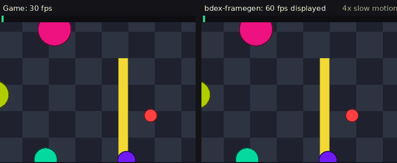
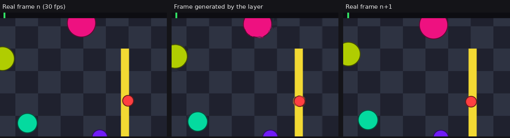
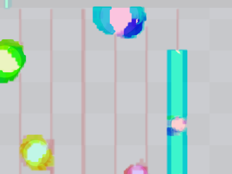

<div align="center">

# bdex-framegen

**Frame generation for Vulkan games on Linux — one layer, no changes to the game.**

[](LICENSE)
[](#)
[](#)
[](#)
[](#validation)

30 fps rendered → **60 to 240 fps displayed** (x2 to x8, or exactly the
screen's refresh rate with the adaptive mode: 50 fps → 144 fps), on any Vulkan
game (native, or Direct3D through DXVK / VKD3D-Proton).



*The demo as the game renders it at 30 fps (left) and what the layer displays (right), in 4x slow motion: every other frame is synthesised.*

</div>

---

## Contents

- [How it works](#how-it-works)
- [Which games](#which-games)
- [Installation](#installation)
- [Usage](#usage)
- [Configuration](#configuration)
- [Performance and quality](#performance-and-quality)
- [Limitations](#limitations)
- [Validation](#validation)
- [Development](#development)
- [Layout](#layout)
- [Contributing](#contributing)

---

## How it works

`bdex-framegen` is an **implicit Vulkan layer** (`VK_LAYER_BDEX_framegen`).
It sits between the game and the graphics driver, grabs every frame the game
presents, estimates the motion between two consecutive frames, and inserts
one or more intermediate frames before the real one.

```
Game ──► vkQueuePresentKHR ──► [ bdex-framegen ] ──► display
                                      │
      game thread (≈ 0.1 ms):         │
      ├─ luma pyramid + hierarchical block matching
      │  (forward and backward optical flow, median filter, 4×4 refinement)
      └─ synthesis of the intermediate frames: bidirectional warping
         weighted by photometric consistency, scene cut detection,
         cross-fade in occluded regions
                                      │
      presentation thread:            │
      └─ copy into the real swapchain, pacing, presentation:
         generated frame(s), then the real frame
```

Design notes:

| | |
|---|---|
| **Virtual swapchain** | The game renders into private images handed out by the layer. The real swapchain belongs to the layer, which decides what to present and when. |
| **Dedicated thread** | The game is never blocked by the presentation of generated frames: `vkQueuePresentKHR` costs it ≈ 0.1 ms. |
| **Separate queue** | The layer's work runs on a compute queue distinct from the game's whenever the GPU has one. |
| **No frame copies** | The images the game renders into double as the frame history: nothing is copied before the analysis. |
| **Latency first** | FIFO is replaced by mailbox + pacing from the GPU's completion (queued frames are pure display latency); the game's present returns just in time for its next frame to reach the GPU (a Reflex-like limiter); an extrapolation mode predicts the next frame instead of holding the real one back, and a hybrid mode (x3/x4) holds it only 1/m of a frame. |
| **All on the GPU** | Compute shaders handle the luma pyramid, flow, synthesis, upscaling and sharpening without a CPU round trip. |
| **Scene cuts** | When the motion cannot be explained and the brightness distribution moved too (a real cut, not grain or fast motion), the layer shows the real frame rather than a blend — per region, so a menu opening over part of the screen is not warped. |



*The middle frame was never rendered by the game: it is synthesised from the two neighbouring frames.*

<details>
<summary>See the estimated optical flow (<code>BDEX_FG_DEBUG=flow</code>)</summary>
<br>


*Hue = motion direction, saturation = magnitude. The static HUD stays grey.*
</details>

---

## Which games

The layer works on anything that presents through a Vulkan swapchain. That
covers more than native Vulkan games:

| Game | How | Status |
|---|---|---|
| Native Linux Vulkan | `BDEX_FG=1 game` | Works (demo, `vkcube`, `vkgears`) |
| Windows Direct3D 8–12 through Steam Play / Proton | `BDEX_FG=1 %command%` — DXVK and VKD3D-Proton translate to Vulkan | **Works** — verified on DXVK (Direct3D 11) and VKD3D-Proton (Direct3D 12) titles |
| Windows games outside Steam (Wine, Lutris, Heroic, Bottles) | Enable DXVK in the runner and set `BDEX_FG=1` in the environment | Same as above |
| Native Linux **OpenGL** | `bdex-framegen --gl -- game`: Mesa's Zink runs OpenGL on Vulkan (`MESA_LOADER_DRIVER_OVERRIDE=zink`, plus `__GLX_VENDOR_LIBRARY_NAME=mesa` and the Mesa EGL vendor — without them the NVIDIA driver keeps the game on its own GL, silently out of reach) | Works (`glxgears` 900 → 1800 fps on NVIDIA, an SDL3 game); Zink itself can be slower than the native GL driver on some games and iGPUs |
| Emulators, 2D engines, anything else | Run it inside [gamescope](https://github.com/ValveSoftware/gamescope) with its SDL backend: `BDEX_FG=1 gamescope --backend sdl -- game` — the compositor presents the whole game through its own Vulkan swapchain. The shipped `[gamescope]` profile exposes `VK_KHR_present_id`/`present_wait`, which gamescope requires. Put `enabled = 1` in a `[gamescope]` section (rather than `BDEX_FG=1`) to avoid generating twice for a Vulkan game inside it. The default Wayland backend presents without a swapchain: no generation there | Works (`glxgears` 337 → 675 fps) |
| Games with anti-cheat (the layer stays out), non-Vulkan programs | `bdex-capture` (capture, see [Capture mode](#capture-mode-bdex-capture-anti-cheat-games-a-second-gpu)) — X11 / Xwayland windows | Works (x2 at 0.6–10 ms on a GPU, plus the X server's round trip) |
| Software rendering / no GPU presentation | — | Not possible |

The layer never sees game logic or input: it only interpolates what reaches
the display, so gameplay, anti-cheat interaction and mods are unaffected.
Steam's overlay and MangoHud sit in the same layer chain and keep working.
MangoHud usually loads *above* the layer (on the game's side): it counts and
draws on the game's frames only, its text then carried into the generated
ones. `bdex-framegen --mangohud -- <game>` (or, in Steam's launch options,
`MANGOHUD=1 VK_INSTANCE_LAYERS=VK_LAYER_BDEX_framegen:VK_LAYER_MANGOHUD_overlay_x86_64:VK_LAYER_MANGOHUD_overlay_x86 %command%`)
puts it under: it shows the frame rate on screen and draws on every frame.
Launchers installed natively (Lutris, Heroic, Bottles, itch…) need nothing:
the layer loads into their games as into Steam's.

---

## Installation

### Distribution packages

Each release also ships the prebuilt layer as packages of the distribution —
installed to `/usr`, updated and removed by its package manager:

| Distribution | Package | Install |
|---|---|---|
| Debian, Ubuntu, Mint, Pop!_OS, Zorin… | `bdex-framegen_<version>_amd64.deb` (`arm64`) | `sudo apt install ./bdex-framegen_*.deb` |
| Fedora, Nobara, openSUSE, RHEL 9… | `bdex-framegen-<version>-1.x86_64.rpm` (`aarch64`) | `sudo dnf install ./bdex-framegen-*.rpm` / `sudo zypper in ./bdex-framegen-*.rpm` |
| Bazzite, Silverblue, Kinoite (immutable) | the `.rpm` | `rpm-ostree install ./bdex-framegen-*.rpm`, reboot — or the archive below, in `~/.local` |
| Arch, Manjaro, EndeavourOS, CachyOS | `packaging/arch/bdex-framegen-bin` (prebuilt) or `-git` (from source, 32-bit layer included) | `makepkg -si` in that directory |
| NixOS | the flake (`flake.nix`) | below |

The same files as the archives (64-bit layer, 32-bit one for 32-bit games,
CLI, panel), in the distribution's library directories
(`/usr/lib/x86_64-linux-gnu`, `/usr/lib64`…). Every CI run installs the
`.deb` on Ubuntu 20.04 to 24.04 and Debian 12, the `.rpm` on Fedora and
openSUSE Tumbleweed, and generates x2 there (`tools/ci/archive-check.sh`);
`tools/package-native.sh <archive>` builds them. A package cannot write into
your home: for **Steam, Heroic, Lutris or Bottles installed as a Flatpak**
(or Steam as a Snap), run `bdex-framegen --sandboxes` once, as your user.

**Flatpak launchers** (Steam, Heroic, Lutris from Flathub): the layer also
exists as a Flatpak Vulkan layer extension, like MangoHud and vkBasalt —
`packaging/flatpak/org.freedesktop.Platform.VulkanLayer.BdexFramegen.yml`
(Freedesktop runtime 25.08, 64 and 32-bit). Once installed (`flatpak-builder
--user --install build-dir <that file>`, or from Flathub when it is
published there), every app on that runtime loads it and `flatpak update`
keeps it current; `bdex-framegen --sandboxes` then copies only the settings
into those apps. Built and loaded by the runtime's loader in CI
(`tools/ci/flatpak-check.sh`).

**Source packages for the distributions' build services** — rebuilt by the
distribution, updated with the system:

| | Recipe | Checked by |
|---|---|---|
| Fedora COPR, openSUSE Build Service | `packaging/rpm/bdex-framegen.spec` (32-bit layer on x86_64: enable multilib in COPR) | `tools/ci/srpm-check.sh` (Fedora, Tumbleweed) |
| Launchpad PPA, OBS for Debian/Ubuntu | `packaging/debian/` (copy to `debian/`) | `tools/ci/debsrc-check.sh` (Ubuntu 24.04, 22.04, Debian 12) |
| Gentoo | overlay `packaging/gentoo` (`games-util/bdex-framegen`, `ABI_X86="64 32"`, `USE=gui`) | `tools/ci/gentoo-check.sh` |
| Void Linux (glibc, musl) | `packaging/void/bdex-framegen/template` (void-packages) | `tools/ci/void-check.sh` |

Each check builds the recipe from the checkout in the distribution's
container, installs the result and checks the libraries and manifests (CI
job `source-packages`). Publishing them needs the repository to be public.

**Laptops with two GPUs**: the game should run on the GPU the screen is
plugged into, or every frame — generated ones included — is copied from one
GPU to the other (`bdex-framegen --report` says so). `bdex-framegen --gpu
screen -- <game>` (or `discrete`, `integrated`, `nvidia`, `amd`, `intel`;
`--gpu list`) sets Mesa's device selection, NVIDIA's PRIME offload and
DXVK / VKD3D-Proton's device filter.

**NixOS** — in the system's flake:

```nix
inputs.bdex-framegen.url = "github:Bdexez/bdex_frame_gen";
# ...
modules = [ bdex-framegen.nixosModules.default { programs.bdex-framegen.enable = true; } ];
```

The module installs the layer and the 32-bit one (`enable32Bit`, on by
default on x86_64) with `share/vulkan` linked into the system profile, where
the Vulkan loader finds implicit layers. (Nix on another distribution: use
that distribution's package or the archive instead — a layer linked against
the store's glibc loads into the host's games, whose glibc may be older.)
Built, and loaded by the store's Vulkan loader, in CI (job `nix`).

### Prebuilt (nothing to compile)

Download from the [GitHub releases](https://github.com/Bdexez/bdex_frame_gen/releases)
(or the `bdex-framegen-linux` artifact of any `linux` CI run):

- `bdex-framegen-linux-x86_64-<version>.tar.gz` — Intel / AMD PCs, Steam Deck
  (64-bit layer, and the 32-bit one for 32-bit games);
- `bdex-framegen-linux-aarch64-<version>.tar.gz` — ARM64: Asahi Linux (Apple
  Silicon), Snapdragon laptops, Raspberry Pi 5…
  (native ARM64 Vulkan programs; on Asahi, Steam's x86 games run in a
  muvm + FEX virtual machine whose x86_64 Vulkan loader cannot load an ARM64
  layer — not covered yet)

```sh
tar xzf bdex-framegen-linux-*.tar.gz
cd bdex-framegen-linux-*/
./install.sh          # into ~/.local: no root, also on immutable systems (SteamOS, Bazzite, Silverblue…)
```

The layers are built on Ubuntu 20.04 and carry their own C++ runtime: they
only need glibc 2.29 (x86_64) or 2.30 (arm64) — Ubuntu 20.04 and later,
Debian 11+, Linux Mint 20+, Pop!_OS, Zorin, Fedora, Arch, Manjaro,
EndeavourOS, SteamOS, Bazzite, openSUSE Leap 15.3+ and Tumbleweed, RHEL 9
and its clones — and work inside Steam's runtime (Proton games). Musl
distributions (Alpine, Void musl) build from source (below). Every CI run
installs each archive as above in other distributions' containers and runs
it on Mesa's software Vulkan with their own loader (1.2.131 to 1.4): it loads
on Ubuntu 20.04 to 24.04, Debian 11 and 12, Fedora, and generates x2 (vkcube)
everywhere Mesa can present to a virtual display — arm64 on Debian arm64
under emulation (`tools/ci/archive-check.sh`).

**Steam, Heroic, Lutris or Bottles installed as a Flatpak**: their sandbox
sees neither `~/.local` nor `~/.config`. `install.sh` also installs the layer
inside each one found (`~/.var/app/<app>/data`, where its Vulkan loader
looks), and the control panel keeps their copy of the settings up to date and
finds their games (each sandbox has its own process numbers). Install the
Flatpak launcher first (and run it once), or run `install.sh` again after
(or `bdex-framegen --sandboxes`). **Steam as a Snap** (Ubuntu's Software
centre) likewise: the layer goes into `~/snap/steam` (`common` for the
library, the manifest and settings in the snap's own home) — written from the
snap's documented layout, not yet tried on a real snap.

The control panel needs `python3-gobject` and GTK 4 (libadwaita is used when
present). Without GTK 4 (Ubuntu 20.04, Debian 11) it runs in text mode, in a
terminal — the same session, options and Steam string (`bdex-framegen-gui
--text` forces it). `./uninstall.sh` removes everything, Flatpak copies
included.
`tools/ci/package-release.sh` builds the same archives (Docker).

### Requirements (building from source)

- Linux with a Vulkan driver whose GPU does compute (Mesa RADV / ANV / NVK /
  Turnip / Honeykrisp / V3DV / lavapipe, NVIDIA…). The engine fits in the
  limits every Vulkan GPU guarantees (4 storage images per shader, 16 KB of
  shared memory — checked by the `min_limits` test); where a GPU allows less
  than 32 KB of shared memory the block matcher's optional terms stay off, and
  a GPU below the guarantees gets its frames passed through, the reason in
  `bdex-framegen --report`.
- To build: CMake ≥ 3.20, GCC ≥ 10 or Clang, the Vulkan headers ≥ 1.3.204,
  `glslc` (shaderc) or `glslangValidator` (glslang); GLFW (optional) for the
  demo. Checked in CI by building in each distribution's container, then
  running the demo through the layer there (`tools/ci/distro-check.sh`:
  Ubuntu 22.04, Debian 12, Fedora, Arch, openSUSE Tumbleweed, Alpine):

```sh
sudo apt install cmake g++ libvulkan-dev glslang-tools libglfw3-dev             # Ubuntu 22.04+, Debian 12+, Mint, Pop!_OS
sudo dnf install cmake gcc-c++ vulkan-headers vulkan-loader-devel glslang glfw-devel  # Fedora
sudo pacman -S cmake gcc vulkan-headers shaderc glfw vulkan-tools                # Arch, Manjaro, SteamOS
sudo zypper in cmake gcc-c++ vulkan-devel shaderc libglfw-devel                  # openSUSE
sudo apk add cmake g++ vulkan-headers vulkan-loader-dev glslang glfw-dev         # Alpine (musl)
```

Older Vulkan headers (Debian 11, Ubuntu 20.04): pass newer ones with
`-DBDEX_VULKAN_INCLUDE_DIR=` (CMake says how). Without a GLSL compiler,
`-DBDEX_SPIRV_DIR=<a build's layer/spv>` uses SPIR-V compiled elsewhere.

### One command

```sh
tools/install.sh      # builds and installs into ~/.local (64-bit, plus 32-bit with multilib)
```

The installation drops:

```
~/.local/lib/libVkLayer_bdex_framegen.so
~/.local/lib32/libVkLayer_bdex_framegen.so                      (32-bit games)
~/.local/share/vulkan/implicit_layer.d/VK_LAYER_BDEX_framegen.json
~/.local/share/vulkan/implicit_layer.d/VK_LAYER_BDEX_framegen_32.json
~/.local/bin/bdex-framegen                                      (launcher)
```

Uninstall: `tools/uninstall.sh`.

The 32-bit layer is built when a 32-bit C++ toolchain is installed:
`gcc-multilib g++-multilib` (Debian, Ubuntu), `glibc-devel.i686
libstdc++-devel.i686 libatomic.i686` (Fedora), `lib32-gcc-libs` (Arch).
The 32-bit Vulkan loader is not needed to build it. `BDEX_NO_32BIT=1`
skips it.

> **Arch Linux**: `packaging/arch/bdex-framegen-git/PKGBUILD` builds a
> `bdex-framegen-git` package (`makepkg -si` in that directory) installing to
> `/usr`, the 32-bit layer included (multilib); `bdex-framegen-bin` packages
> the release archive.

### Windows

Two products, built by the Windows CI (download the `bdex-framegen-windows-x64`
artifact or a release zip) — see [`docs/windows-README.md`](docs/windows-README.md):

- **`bdex_capture.exe` — recommended.** Captures a game's window
  (Windows.Graphics.Capture), generates frames with the same engine and shows
  them in an overlay on top of the game. Works with every API (Direct3D 9–12,
  OpenGL, Vulkan) and is safe with anti-cheats (nothing is injected), at the
  cost of about one frame of latency. Run it without arguments for the
  launcher (window picker, options, per-game profiles, global on/off hotkey).
  Validated on hardware on D3D9/11/12 titles (Intel iGPU + RTX 3050).
- **The Vulkan layer DLL** (native-Vulkan games and emulators): register it
  with `tools\register-layer.ps1`, then enable it per game from Steam's
  launch options (`cmd /c "set BDEX_FG=1 && %command%"`). Built and
  unit-tested by the CI but **not yet validated on Windows hardware**.

<details>
<summary>Manual build</summary>

```sh
cmake -S . -B build -DCMAKE_BUILD_TYPE=Release
cmake --build build -j
cmake --install build --prefix ~/.local

# 32-bit variant (multilib required)
cmake -S . -B build32 -DCMAKE_BUILD_TYPE=Release -DBDEX_32BIT=ON
cmake --build build32 -j && cmake --install build32 --prefix ~/.local
```
</details>

---

## Usage

Once installed the layer loads into **every** Vulkan game automatically, but
stays a pure pass-through — it does nothing until you turn it on. There is
nothing to add to your Steam launch options.

### Control panel (recommended)

Run **`bdex-framegen-gui`** (or `bdex-framegen --gui`, or the *bdex-framegen*
entry in the applications menu), the way you would open Lossless Scaling:
launch your game normally (Steam...), pick it in **Jeux détectés**, set the
options, **Démarrer**. Frame generation starts in that game and the options
apply live; **Arrêter**, or closing the panel, stops it. Every Vulkan game is
armed meanwhile (the layer passes its frames through), desktop programs
excepted (browsers, Steam, gamescope, GTK 4 applications).

**GPU calibration** (*Calibration du GPU*, measured by itself at the first
start; `bdex-framegen --calibrate [--apply]` from a terminal): `bdex-calibrate`
runs the engine on synthetic frames at the screen's size and refresh, for the
automatic preset and each fixed one, and recommends the preset and the highest
multiplier whose cost stays within a quarter of the GPU's time (no game below
30 fps: 60 Hz x2, 144 Hz x4, 240 Hz x8). *Appliquer* takes them; *Auto* never
goes above the calibrated multiplier anyway. **Record** (the button on a
detected game): its next 150 real frames for the evaluation corpus
(`~/.cache/bdex-framegen/recordings`, packed by `tools/corpus_pack.py`).
Panel recordings include `timestamps.csv`, sampled at each source present;
`python3 tools/recording_report.py SEQUENCE` reports frame-time variation.
`bdex_demo --replay SEQUENCE --replay-timing --replay-log /tmp/replay.csv`
reproduces those intervals through the online path instead of using `--fps`,
then stops at the last selected source. Missing/inconsistent timestamps are
rejected. The log records requested and actual source presents; if a frame
is late by over 0.5 ms, following deadlines shift instead of catching up in
a burst. Reported shifts identify replay overload. This timing mode is
separate from the constant-rate quality benchmark, `replay_bench.py`.
Packing and unpacking preserve these times when selecting a subsequence.

**Without the panel** — *Mode Jeu — sans le panneau*: every game (*Tous les
jeux*), or the selected one, generates from its start with the panel's
settings, the panel closed. That is how Steam's Game Mode is used (below),
also from a terminal: `bdex-framegen --always-on [GAME]` / `--always-off`.

Everything is written to `~/.config/bdex-framegen.conf`, which the layer reads
on its own (games in a Flatpak launcher get a copy). The panel needs Python 3
with PyGObject and GTK 4; libadwaita 1.4+ is used when present.

### Steam Deck / SteamOS

Install in **Desktop Mode** (Konsole), into `~/.local` — SteamOS's read-only
system is not touched, and its updates keep it:

```sh
tar xzf bdex-framegen-linux-x86_64-*.tar.gz && cd bdex-framegen-linux-x86_64-*/ && ./install.sh
```

The control panel runs in Desktop Mode (SteamOS ships GTK 4 and PyGObject).
**Game Mode** runs one application at a time, so the panel cannot stay open
beside a game there. Either:

- *Mode Jeu — sans le panneau* in the panel (or `bdex-framegen --always-on
  [GAME]`): every game, or the chosen one, generates from its start in Game
  Mode, with the panel's settings — change them in Desktop Mode, or live from
  the config file; or
- per game, Steam's launch options (*Properties → Launch options*, also
  editable in Game Mode): `BDEX_FG=1 %command%` — the panel's copy button
  gives the whole line with its settings.

**Steam's framerate limit** (Quick Access Menu → Performance) caps what
gamescope shows, generated frames included: under it the layer only fills up
to the limit (a 30 fps game under a 30 fps limit gets no generated frame, a
20 fps one is brought to 30), keeping one frame queued at most. For 60 fps
from a 30 fps game, set the limit to **Off** (or to the refresh rate: 60, or
90 on an OLED Deck) and cap the game itself — its own limiter, or `fps_limit
= 30` — or let *Adaptatif* fill the refresh rate. `bdex-framegen --report`
and the panel say when the limit is on. Measured in gamescope 3.16 (the
SteamOS 3.9 one) with that limit at 30 fps, a 30 fps game at x2: 30 fps and
19–66 ms from present to screen, where it fell to 15 fps and 233 ms before;
x2 again, without a queue left behind, once the limit is lifted.

gamescope's own refresh rate (and the limit) comes from its WSI layer, so
*Auto* and *Adaptatif* know the Deck's 60 / 90 Hz at once. HDR (OLED) passes
through, metadata included. On the Deck's integrated GPU the automatic preset
is *performance*. The same holds in any gamescope session (Bazzite,
ChimeraOS...).

### Capture mode: `bdex-capture` (anti-cheat games, a second GPU)

`bdex-capture` generates frames for a game **window** by capture, like
Lossless Scaling, instead of inside the game: nothing is loaded into the
game. Use it for the games the layer stays out of (anti-cheat), for programs
that do not present through Vulkan, and to generate on **another GPU** than
the game's — the one driving the screen (`--gpu`), Lossless Scaling's
two-GPU setup.

```sh
bdex-capture --list                       # the windows it can capture
bdex-capture --name "Game title" -m 2     # or --pid PID, --window 0xID; nothing: click the window
bdex-capture --list-gpus                  # then --gpu 1 (or a part of its name: --gpu radeon)
```

X11 sessions and Xwayland windows (most Proton games on a Wayland desktop):
the game window is redirected off-screen (XComposite), each new frame comes
as an XDamage event and is read with MIT-SHM straight into GPU-visible memory
(host-memory import, no copy where the driver allows it); an
override-redirect overlay without input region shows the real and generated
frames above the game and follows it, clicks and keys going through to it.
The settings are the layer's (configuration file with the game's `[section]`,
`BDEX_FG_*`), then `-m`, `--mode`, `--preset`, `--hud`. Ctrl+Alt+G toggles
the generation, Ctrl+Alt+Q quits (`--hotkey` rebinds the toggle).

**Native Wayland windows** (a native game, Wine's Wayland driver):
`bdex-capture --wayland [--name GAME] [--rect X,Y,W,H]` goes through the
desktop's screen-cast portal — the desktop asks once which window to share
(the choice is kept for the next times) — and PipeWire; the frames are read
in place as on X11. A Wayland window's position is the compositor's, so the
overlay covers `--rect`, by default the whole screen: a fullscreen game's.
`--screen` shares a whole screen instead (then show the result on another
screen: the overlay would be captured too). In the panel: *Fenêtre Wayland
(portail)…*. Checked end to end in a container (`tools/ci/wayland-capture-check.sh`:
sway headless, xdg-desktop-portal-wlr, PipeWire): a 30 fps game x2.00, read
in place, 20 ms from the frame to the screen.

Measured on an RTX 3060 Ti (a 60 fps game, 144 Hz): x2 120 fps with 10 ms
from the game's frame to the screen in interpolation, 0.6 ms in
extrapolation; hybrid x3 178 fps, 8 ms (from the frame's arrival at the X
server: the game's own presentation to it and the compositing of the overlay
come on top). The layer, inside the game's presentation, stays the first
choice when it can load. Not available: inside gamescope (Steam Deck Game Mode), where games
present through gamescope's own WSI layer, not to the X window; native
Wayland windows (the PipeWire screen-cast portal is not implemented yet).

### Turning it on by hand

`~/.config/bdex-framegen.conf` is a plain INI file. `[*]` applies to every game;
a `[name]` section applies to the game whose executable is `name`:

```ini
[*]
enabled = 0            # off for everything by default
preset  = balanced

[kenshi]
enabled = 1            # ...but on for Kenshi, no launch options needed
multiplier = 3
```

### Environment variables (per-game, still supported)

Setting `BDEX_FG=1` turns the layer on for a single process, overriding the
config file — handy for a one-off, from the command line, or as a per-game
Steam launch option:

```sh
BDEX_FG=1 ./my_game                      # x2 (default)
bdex-framegen -m 3 -- ./my_game          # x3 through the launcher
bdex-framegen -x -- ./my_game            # extrapolation: no added latency
bdex-framegen --preset performance --profile -- vkcube
bdex-framegen --check                    # does the loader find the layer?
```

**Steam** → game properties → *Launch options*:

```
BDEX_FG=1 %command%
BDEX_FG=1 BDEX_FG_MULTIPLIER=3 BDEX_FG_MODE=extrapolate %command%
```

Without installing, from the build tree:

```sh
VK_IMPLICIT_LAYER_PATH=$PWD/build/layer BDEX_FG=1 ./build/demo/bdex_demo --fps 30
```

This command uses the build-tree layer even if another version is installed.

The layer periodically prints its statistics to the terminal:

```
[bdex-fg  4.128 INFO] game 30.0 fps -> output 60.0 fps (x2.00), present call 0.14 ms, real frame delayed 17.1 ms
```

### The demo

`bdex_demo` renders a procedural scene (moving objects, static HUD, frame
counter) at a capped frame rate, to test without a game:

```sh
build/demo/bdex_demo --fps 30               # without the layer: 30 fps
BDEX_FG=1 build/demo/bdex_demo --fps 30     # with it: 60 fps displayed
build/demo/bdex_demo --help                 # --size, --mode, --speed, --cut, --srgb…
```

`--latency-test` answers every key press (`--latency-test auto`: one
"input" every half second) with a flat white frame, and `--latency-log FILE`
records when each input came and when its frame was presented — the game
side of an input-to-screen measurement (see Latency).

---

## Configuration

Every option can be set through `BDEX_FG_<KEY>` environment variables or in
`~/.config/bdex-framegen.conf` (`key = value`, one per line; the environment
takes precedence).

Per-game profiles verified by the project ship in
`<prefix>/share/bdex-framegen/profiles.conf` (next to the DLL on Windows) and
are applied before your file, which overrides them. They only tune a named
game: they never enable the layer or pause it (`BDEX_FG_PROFILES=` disables
them).

| Key | Default | Description |
|---|:---:|---|
| `BDEX_FG` / `ENABLED` | – | `1` enables the layer, `0` disables it |
| `MULTIPLIER` | `2` | frames displayed per rendered frame: 2 to 8 (x8: 30 fps on a 240 Hz screen). Past what the screen's swapchain lets the layer hold at once, the frames of a present are staged in internal images, so the game never waits for the pacing. |
| `MODE` | `interpolate` | `extrapolate` predicts the next frame from the last two: no added latency, more artefacts on abrupt motion. `hybrid` (x3/x4): one interpolated frame, then the real frame, then predicted ones — the real frame is 1/m of a frame late instead of (m−1)/m (x4: a quarter of a frame instead of three quarters) and no prediction reaches as far as in pure extrapolation (offline, demo x4: −1.3 to −2.4 dB from interpolation, against −3.0 to −4.7 for extrapolation; x3: −1.0 to −1.4, against −3.4 to −4.4). At x2 it is interpolation. |
| `PRESET` | `auto` | `auto` picks `performance` for integrated/small GPUs and `balanced` for discrete GPUs with at least 2 GiB of VRAM; or force `quality` (full-resolution flow up to ~1080p, half resolution above — at 1440p the full-resolution pyramid followed a third of the camera motion: recorded games +0.3 to +0.5 dB at half the flow's GPU time), `balanced`, `enhanced` (balanced flow plus the opt-ins measured positive together: `ZERO_BIAS_CONTRAST=0.02`, `PIXEL_VECTORS`, `FLOW_TEMPORAL`, `HUD_MASK=24`, `SCENE_CUT_LOCAL`, `DEDUP`, `EXTRAPOLATE_SPLAT` — offline vs the defaults: interpolation +0.08 to +10.8 dB, demo +0.71; extrapolation −0.04 to +7.1 dB, demo +2.0; about twice the synthesis time), `performance` (quarter-resolution flow, ~2× cheaper), `latency` (extrapolation + x2 for minimal input lag). On a discrete GPU every preset but `performance` also turns on the synthesis options of the automatic preset (`PIXEL_VECTORS`, `INTERP_SPLAT`, `ROT_WEIGHT`, `TEMPORAL_PREDICTION`, `ZERO_BIAS=0`, `SCENE_CUT_LOCAL`, the extrapolation splat); until 2026-10-13 an explicit preset dropped them (`quality` on a real game: 17–20 % more grossly wrong pixels at x2/x3) |
| `FLOW_SCALE` / `FULLRES` | `auto` / – | resolution divisor of the flow: `1`, `2`, `4`; `auto` keeps the flow around 0.5 Mpixel; `FULLRES=1` is `FLOW_SCALE=1` |
| `LEVELS` | `4` | flow pyramid levels (1–6) |
| `SEARCH` / `SEARCH_FINE` | `4` / `2` | search radius at the coarsest level / at the finer levels (1–4); the `quality` preset searches 3 at the finer levels (recorded games +0.02 to +0.08 dB, less flicker, +0.1 to +0.2 ms of flow at 1440p) |
| `RENDER_SCALE` / `UPSCALE` | `1.0` | render resolution / display resolution (`0.5`–`1.0`); below 1 the game renders smaller and every frame is upscaled to the display size. `UPSCALE=<ratio>` sets it as a ratio (e.g. `1.5`). Works on X11, Xwayland and native Wayland |
| `UPSCALE_FILTER` | `lanczos` | upscaling reconstruction filter: `bilinear`, `bicubic` (Catmull-Rom) or `lanczos` (Lanczos-2) |
| `SHARPNESS` | `0` | contrast-adaptive sharpening (CAS) after upscaling, `0` (off) to `1` (strong); applies to real and generated frames |
| `UPSCALE_TEMPORAL` | `0` | Experimental, with `RENDER_SCALE` < 1 and frame generation on: flow-guided temporal upscaling. The real frame is upscaled into a display-size history, blended with the previous one carried along the measured motion (TAA-style: clamped to the current 3×3 neighbourhood, no history across scene cuts, outside the picture or where the forward flow does not lead back), and the generated frames are synthesised from these upscaled frames instead of bilinear samples of the small ones. The value is the history weight. Offline at `RENDER_SCALE=0.5`, real and generated frames scored, `0.05`: smooth pan +1.29 dB, sub-pixel pan +0.71 dB, HUD scene +0.16 dB (flicker −30 %), demo +0.06 dB, swinging camera +0.03 dB; at `0.75` within ±0.1 dB (HUD scene −0.13 dB). Most of the gain is the synthesis from the upscaled frames: games do not jitter their camera for us and the flow is integer, so a heavier accumulation blurs (`0.5`: −0.6 to −1.6 dB except smooth pans). `0.05` advised; about one display-size pass of GPU time. Read at start-up. |
| `OVERLAY` | `0` | on-screen fps counter in the top-left of every frame (alias `HUD`). Level `0` off, `1` output fps, `2` `game > output`, `3` adds the `1%` low, `4` adds the `.1%` low, `5` adds the measured latency from the game's present to the screen (`--ms` where the driver cannot report display times, see `PRESENT_FEEDBACK`). `6` adds the **pacing graph** under it: one column per present, its height the game's frame time (green near the interval the pacing aims at — the grey line —, amber past 1.25×, red past 2×: a stutter; grey when no frame was generated with it: catch-up, `SKIP_FAST`, pause), a red mark when a frame was replaced before being displayed. Also accepts `off`/`fps`/`framegen`/`low`/`full`/`latency`/`pacing`. The lows are the game fps at the 99th / 99.9th percentile frame time |
| `SMOOTHNESS` / `ZERO_BIAS` | `0.003` / `auto` | block-matching penalties: per pixel of deviation from the coarse prediction (0.004 before 2026-10-14: recorded games up to +0.08 dB, less flicker; 0.002 lost 1.5 dB on a near-periodic scroll) / toward zero motion (keeps static HUDs still; see `ZERO_BIAS_CONTRAST`). `ZERO_BIAS`: `0.002`, or `0` on a discrete GPU (automatic preset, or any preset but `performance`) — the free bonus of "no motion" made soft content in fast motion blend into a ghost (960×540 corpus: interpolation zoom +1.6 dB, pan +0.5; hybrid x3 pan +1.5, zoom +1.7; extrapolation pan +1.6, zoom +2.2; losses: occlusions −0.1 to −0.3 dB, HUD −0.13 in hybrid); a static HUD still matches exactly at zero motion. |
| `GRAD_WEIGHT` | `0` | opt-in gradient SAD term in the matching cost: fast motion +0.5 dB, normal −2.1 dB |
| `REFINE_BIAS` | `0.5` | SAD bonus (over 64 px) for a block keeping its own flow in the 4×4 refinement |
| `REFINE` / `REFINE_ALL` | `1` / `1` | 4×4 flow refinement pass, on every level or only the finest |
| `FLOW_ITERATIONS` | `1` | fixed-point iterations of the flow lookup in the interpolation (0–3) |
| `CENSUS_WEIGHT` / `CENSUS_MARGIN` | `0` / `0.05` | opt-in discrimination for the block matcher: when the runner-up scores within the margin of the winner, near-winners are re-ranked on census (rank-transform) Hamming distance. `census_weight=2` + `census_margin=1` buys ≈ +0.5 dB on fast motion at ≈ −1.5 dB on static/small-motion scenes; `0` is off (bit-for-bit) |
| `CHROMA_WEIGHT` | `0` | Experimental: lets the block matcher see colour. Luma alone cannot see an edge between two colours of the same brightness (red on green, a coloured light on a grey wall) — those areas cross-fade instead of moving. Where a block's luma is low-contrast, the candidates luma cannot separate are re-ranked on a Cb/Cr pyramid, and a challenger must halve the incumbent's colour mismatch. A challenger must also keep the block's course from the previous frame pair (an alias of a scrolling pattern jumps around). Offline: isoluminant colours +10.7 dB (interp), a smooth colourful pan +11.7, a swinging camera +3.2, neutral elsewhere. Known loss: nearly isoluminant stripes that scroll faster than their period (the demo's hatched box, −0.8 dB overall) — chroma can still lock onto an alias. Builds a chroma pyramid (read at start-up; the weight itself is live). `1` to enable. |
| `ROT_WEIGHT` | auto | Rotation / scale re-ranking for the block matcher: ambiguous, non-static blocks re-evaluate their top-2 displacements under local rotations (±10/±30°) and scales (0.92/1.08); the flow stays a translation, only the winner can change. Measured on top of `PIXEL_VECTORS`: occlusions +1.17 dB, 8° a frame rotation +1.09, 5 % zoom +1.1, scrolling text +0.40, sub-pixel pans +0.23, the demo +0.07 to +0.12, nothing lost. It runs in a matcher variant of its own (the full one, with every opt-in's shared memory, halved the occupancy: the flow cost 2.4×, now 1.5×). On by default on discrete GPUs (`1` there), off elsewhere; `0` is the historical matcher, bit for bit. |
| `OCCLUSION_STRENGTH` | `0` | Experimental interpolation confidence and reduced cross-fade fallback, from `0` (historical output) to `1`. On the demo, `1` improves PSNR in newly revealed regions but can add GPU cost; keep disabled until validated on games. |
| `STATIC_GUARD` | `0` | Experimental, interpolation only: pixels identical in both frames keep the current frame, so static HUD/UI elements over moving content stop smearing with the block's motion. Measured offline: +1.0 dB on a HUD-over-panning scene (minimap +4.4 dB), neutral on the demo, −0.2 dB on its fast-motion variant (small fast objects crossing a pixel are dropped there). `1` to enable. |
| `ZERO_BIAS_CAP` | `0.006` | `ZERO_BIAS` stops growing at this cost (3 px at the default 0.002 per pixel): a true fast motion pays no more than a small one. Proportional to the displacement, the bias charged a 16 px motion eight times what it charges a 2 px jitter — exactly the fast pans it broke (the free zero-motion candidate won and the picture cross-faded) — while static HUDs only need "moving" to cost something. Offline vs uncapped: smooth pan +2.7 dB, swing +2.4, occlusions +0.7, very fast demo +0.1, demo and HUD ±0.06, nothing visible lost. `0` = uncapped (the pre-0.6 matcher). |
| `ZERO_BIAS_CONTRAST` | `0.02` | Makes `ZERO_BIAS` relative to the block's contrast (full bias from this mean luma gradient up, proportionally less below), so smooth or low-contrast content in fast motion stops cross-fading while textured static HUDs keep their protection. `0.1` measured non-negative everywhere: demo +0.02 dB, `--speed 2` +0.48 dB (rotating edges +2.7 dB), smooth pan +17 dB. On the offline demo replay (2026-09-25), `0.1` lost 1.7 dB alone and 1.2 dB with `PIXEL_VECTORS`, where `0.02` gains (+0.7 with the `enhanced` preset's options): prefer `0.02` unless `ONLINE_TUNE` decides. Default since 0.4: never below −0.01 dB on the corpus and the demo replay in either mode, demo +0.10 dB interpolation / +0.83 dB extrapolation, smooth pan +9.6 / +6.4, swing +2.3 / +0.9, flicker down; no measurable GPU time. `0` restores the historical matcher. |
| `PIXEL_VECTORS` | `auto` | Interpolation: at object boundaries the bilinear flow lookup blends two motions; this tries the unblended vectors of the four surrounding flow blocks per pixel and keeps the most consistent trajectory — only where those four and the looked-up vector disagree (a motion boundary, an unconverged lookup): elsewhere the result would be the same, for about half the cost. Offline vs off: demo +0.3 dB, very fast demo +0.6, HUD scene +0.7, occlusions +2.9 dB (their edges +6.6). GPU, RTX 3060 Ti: about +0.15 ms at 1440p and +0.3 ms at 4K per generated frame (since 03/10: the synthesis is compiled for the options in use). On by default on a discrete GPU (automatic preset, or any preset but `performance`), as long as display pixels × generated frames stay at or under 4K ×3 (1440p ×5, 1080p ×8); `0` / `1` force it. |
| `HUD_MASK` | `auto` | Experimental: learned static-overlay mask. Per render pixel, the engine counts the real frames it stayed unchanged while the camera moved (a quarter of the pixels changed); past this many frames (`24` advised) the pixel is an overlay — HUD, minimap, crosshair — and every generated frame keeps it exactly as in the real frame instead of moving it with the flow. Nothing is learned with a fixed camera (a still background an object then crosses is not an overlay); any change resets a pixel. HUD scene: +0.91 dB interpolated (moving edges +1.4 dB), +0.61 dB extrapolated — where `STATIC_GUARD` does nothing; the demo and the scenes without overlay unchanged. Enabling it is read at start-up, the threshold live. | **On by default on a discrete GPU (automatic preset, or any preset but `performance`) since 2026-10-13, at `4` since 2026-10-14** (a HUD element that appears is held after 0.13 s at 30 fps: HUD scenes +0.01 to +0.16 dB, extrapolation +0.13; `2` took still-looking scenery for HUD, low contrast −0.72 dB): on 30 fps game-like scenes at x4 (static HUD over a camera turn) the HUD icons came out smeared and doubled — interpolation +0.21 to +0.47 dB (+0.9 to +2.0 dB on edges), extrapolation +0.67 / +1.06; nothing lost on recorded games, the corpus or scenes without a HUD. `0` turns it off.
| `STATIC_SOFT` | `auto` | With `HUD_MASK` (interpolated and, since 15/10, predicted frames — toward the current frame there: extrapolation HUD scenes +0.05 to +0.42 dB): the mask pass also keeps, per pixel, a moving average of the evidence that the "still" hypothesis explains the pixel at least 2–4 times better than the scene's motion (from the backward flow) while the scene there moves — a HUD's anti-aliased text, whose 1–2 pixel strokes mix the moving scene and are never quite unchanged, so the hard mask misses them; such pixels lean toward their place by the evidence (a moving object crosses a pixel once, a HUD holds frame after frame). x4 on 30 fps game-like scenes with anti-aliased HUD text: +0.05 to +0.25 dB, edges +0.5 to +4.5 dB; recorded games and the corpus within −0.02 dB. On by default on a discrete GPU (automatic preset, or any preset but `performance`); `0`–`1` strength. Perceptual encodings, sRGB formats and HDR10 (PQ).
| `SUBPIXEL_LK` | `0` | Experimental: sub-pixel refinement of the finest flow by Lucas-Kanade (Gauss-Newton steps, `1`–`4`; `2` advised) over an 8×8 window, kept only where the window has texture in both directions, the vector stays within one pixel of the matched one and the SAD drops. About +0.1 ms (the parabolic `SUBPIXEL` costs ~+0.5 ms). Extrapolation: sub-pixel pan +2.1 dB. Interpolation: pair it with `SYNTH_BICUBIC` (alone −0.8 dB on a sub-pixel pan, like `SUBPIXEL`: the bilinear sampling of the synthesis blurs). Its accuracy shows in `UPSCALE_TEMPORAL` accumulation: at weight 0.3, sub-pixel pan +0.83 dB, swinging camera +0.01 dB (without: +0.14 / −0.57), better than `SUBPIXEL`. An `ONLINE_TUNE` candidate in extrapolation. |
| `SYNTH_BICUBIC` | `0` | Experimental: the synthesis samples the frames along the trajectories with Catmull-Rom (9 bilinear taps, clamped to the 2×2 neighbourhood) instead of bilinear, which low-passes wherever a trajectory lands between pixels. With `SUBPIXEL_LK=2` / `SUBPIXEL=1`: sub-pixel pan +0.37 dB interpolated, demo +0.09 / +0.12 dB; neutral elsewhere (±0.03). About +0.6 ms of synthesis on a 1.7 Mpx frame (RTX 3060 Ti). `1` to enable. |
| `SUBPIXEL` | `0` | Experimental: parabolic sub-pixel fit of the finest flow (block matching is otherwise integer, i.e. 2 display pixels at `flow_scale` 2). Demo +0.08 dB, fast +0.06 dB, moving edges +0.1–0.2 dB; with `ZERO_BIAS_CONTRAST=0.1`: +0.10 / +0.54 dB. `1` to enable. |
| `GLOBAL_MOTION` | `auto` | The frame's dominant shift, found by an exhaustive search at the coarsest pyramid level (±16 of its pixels), becomes a second search centre for each coarsest block, which keeps whichever its own pixels match better: a fast camera turn (a mouse flick: 180+ px a frame at 1440p) no longer goes past the pyramid's reach and breaks the picture up, while objects moving on their own keep their prediction (adding a pyramid level instead coarsens the blocks: −1.3 dB on a game-like scene with independent objects). Recorded games (PRAGMATA, Oblivion Remastered), fast turns at 1440p: grossly wrong pixels −17 to −19 %, +0.3 to +0.8 dB; at 853×480 −1 to −13 %; everything else within ±0.04 dB; ~0.05 ms. On by default on a discrete GPU (automatic preset, or any preset but `performance`). `0` / `1` force it. |
| `TEMPORAL_PREDICTION` | `auto` | The coarsest matching level searches around the previous frame pair's motion instead of zero, so sustained fast camera pans are followed beyond the pyramid's search range. On by default on a discrete GPU (automatic preset, or any preset but `performance`) (no GPU cost; on the 960×540 corpus with the other automatic options: interpolation x2 occlusions +3.7 dB, zoom +4.4, demo +0.15 to +0.19; hybrid x3, where a pair moves more, HUD +9.8, pan +11.7; losses up to −0.4 dB on a rotation, a menu, a swinging camera). Works even better with a low `ZERO_BIAS` (on a 64 px/pair pan: +12.4 dB with `ZERO_BIAS=0`). `0` / `1` force it. |
| `EXTRAPOLATE_SPLAT` | `auto` | Predicted frames (extrapolation, hybrid); on by default on a discrete GPU (automatic preset, or any preset but `performance`) (with `REVEAL_FILL`: extrapolation x3 demo +0.9 dB, fast +1.2, pan +1.2, HUD +0.7; hybrid +0.2 to +0.6; nothing lost). `0` / `1` force it. forward-splats the current frame to its predicted position (the most consistent, fastest-moving pixel wins where several land) and backward-warps only the uncovered areas. Demo +1.08 dB, fast +0.41 dB, moving edges +1.56 dB, x3 +1.05 dB; about +0.8 ms of GPU time on a Vega 8. `1` to enable. |
| `INTERP_ACCEL` | `auto` | Interpolation: where the motion changed since the previous pair (a mouse turn speeding up or slowing down), the content moves on a curve between the two frames, not a straight line — with a constant acceleration `a` it is `a·t(1−t)/2` behind the straight line at time `t` (`a/8` halfway). The acceleration comes from the previous pair's backward flow (as `EXTRAPOLATE_ACCEL`), once a frame at the flow's resolution (`accel_map.comp`), averaged over ~80 pixels of neighbours moving alike and kept only where they agree on it (across an object's edge the previous flow lands on another object: without the test, objects at constant speed lost 0.4 dB). Recorded games (PRAGMATA, Oblivion, Cyberpunk): +0.03 to +0.17 dB, flicker −0.04 to −0.51, grossly wrong pixels down on every one; scenes at constant speed within −0.02 dB, one upscaled recording −0.09; +0.1 ms a game frame at 1440p x4. On by default on a discrete GPU (automatic preset, or any preset but `performance`); `0`–`1` weight. With timed frames (`FRAME_TIMING`, or `CONTENT_CLOCK` with display times), accounts for both source intervals so cadence changes do not become false acceleration. Timing does not invent stronger or reversed curvature; the noise floor follows vector uncertainty. Nearly equal intervals (within 0.5%) keep the historical expression. Duplicate detection keeps its existing path. Applied live. |
| `FALSE_DETAIL` | `auto` | Generated frames (interpolated and predicted): fine detail in a generated frame that neither input has within 16 pixels is the synthesis's own — the edges between neighbouring blocks that took different vectors, a mosaic over motion-blurred or low-contrast content where block matching guesses — and leans to its 5×5 average (`false_detail.comp`, over the finished frame: the generated frame's mean \|Laplacian\| over 5×5 above 1.5× the most detailed 4×4 cell of either input within 16 pixels, a window that covers the motion so an object's real edges crossing a flat background are kept; detail present at the pixel in both inputs — a still HUD — is left alone). 1440p recordings (PRAGMATA, Oblivion) +0.14 / +0.07 dB, flicker −0.39 / −0.18, grossly wrong pixels down; x4 game-like scenes +0.03 to +0.21 dB; recorded games at 853×480 +0.00 to +0.03; nothing lower on any sequence, the synthetic corpus unchanged. Extrapolation (`MODE=extrapolate`, the hybrid's predicted frames): every sequence up, +0.15 dB on average (1440p +0.13 / +0.26, flicker −0.5 / −1.1). ~1 ms of GPU a generated frame at 1440p, plus ~0.3 ms a game frame for the inputs' detail map (a fast-moving 1440p recording; the first generated frame waits for both: ~1.3 ms of latency there). Packed 8- and 10-bit formats, SDR or HDR10 (PQ: x4 HDR10 scenes +0.05 to +0.14 dB), without upscaling. On by default on a discrete GPU (automatic preset, or any preset but `performance`); `0`–`1` strength. Applied live. |
| `BORDER_PREDICT` | `auto` | Motion search: in a camera move, content entering or leaving the picture has its match off-screen, where the matcher compares against the repeated edge pixels and any candidate it finds is wrong — the edge of the picture smears. A block whose predicted match (the coarser level's motion; the camera's at the coarsest, `GLOBAL_MOTION` / `TEMPORAL_PREDICTION`) lies mostly off-screen keeps that prediction and skips the search. x4 camera turns +0.15 to +0.19 dB at 720p and 1440p; recorded PRAGMATA flicker −0.25 / −0.32, grossly wrong pixels down; Cyberpunk and Oblivion within 0.02 dB; worst −0.06 dB on an edge scene; the synthetic corpus's menu popping up over noise −0.33, HUD −0.15. Free. On by default on a discrete GPU (automatic preset, or any preset but `performance`); `0` keeps the historical matcher. Applied live. |
| `BORDER_FILL` | `auto` | Interpolation: in a camera turn, the content entering the picture is in the current frame only and its backward flow is garbage (its match is off-screen), so both trajectories looked bad and the pixel fell to a cross-fade — a smear along the edge, up to a tenth of the width in a fast turn. Where the forward flow at the pixel is a shift of the picture there (the same 32 px further in) and puts its content off-screen in the previous frame, it is taken from the current frame along that motion (the mirror for content leaving, from the previous frame), unless a trajectory found explains the pixel or the source is a still overlay. x4 game-like scenes: walk +0.47 dB, turn +0.13, first-person turn +0.11; recorded games −0.02 to +0.06. On with a discrete GPU. |
| `HUD_AVOID` | `auto` | Interpolation with `HUD_MASK`: the scene between still HUD elements moves behind them, and its trajectories can run from overlay pixel to overlay pixel — consistent, so they won, and the icons' colour was copied into the gaps between them as bars. Where the pixel is not an overlay pixel itself, such a trajectory counts as broken and the other one (or the fallback) decides. x4 game-like scenes: walk +1.03 dB, strafe +0.61, turn +0.28, dark +0.25, first-person +0.18 (their HUD icons from 18–29 to 26–36 dB); recorded games unchanged. On with a discrete GPU. |
| `MOSAIC_BLUR` | `0` | Interpolation: where the finest flow is chaos — over half the flow texels around a pixel agree with fewer than 7 of their 8 neighbours (about 1 % of the width) — the generated frame leans to its local average (one flow block): a character turning on itself in a fast camera move comes out as a mosaic of unrelated blocks, which then shimmers less. Recordings: PRAGMATA +0.14 dB, flicker −0.17, Oblivion +0.07, Cyberpunk +0.03; game-like scenes +0.01 to +0.02 dB but sharp edges moving on their own up to −0.5 dB there — hence off by default. 0..1; packed 8/10-bit formats, no upscaling. |
| `RECORD_SCALE` | `0` | The control panel's recordings of a game's real frames (corpus for the quality tools): written at 1/N of the game's size, `1` = full size; `0` = about 960 pixels wide (a third at 1440p, where the HUD's thin strokes never stay exactly still, so HUD handling cannot be judged on them — use `1` or `2` for that). |
| `PARALLAX_SEARCH` | `0` | Motion search: in a sideways move, thin near structures — a railing's posts, fences, pillars — pass faster than the scenery behind them (parallax), and the hierarchical search gives them the background's vector (at the coarse levels a post a few pixels wide is averaged away, the finer levels search a few pixels around the coarse motion): they break up in the generated frames. Where the finest flow explains its 8×8 window poorly, multiples of its own vector (×0.5, ×1.5–×3) are tried, a pixel either side along the motion, and kept where they explain the window clearly better and the other direction agrees (around where the content lands). Railing scene at x4 +0.32 dB, flicker −0.21, grossly wrong pixels −11 %; sideways moves +0.02 / +0.03; everything else within 0.02 dB. Costs ~0.3 ms of GPU a game frame on a fast-moving 1440p game, on the generated frames' latency path — hence off by default. Applied live. |
| `EXTRAPOLATE_ACCEL` | `0` | Experimental, extrapolation only: predicts along a curved trajectory, using how the motion changed since the previous frame pair (acceleration), instead of constant velocity. The acceleration is averaged over neighbouring blocks moving alike and ignored where the motion is unreliable or the content just entered the picture. Offline, a camera swinging back and forth: +1.0 dB (x2), +2.7 dB with `ZERO_BIAS_CONTRAST=0.1`; constant motion neutral (±0.02) except a smooth fast pan −0.13 dB; online demo fast motion +0.13 dB (revealed areas +0.8), normal −0.01. `0`–`1` (weight), `0` is off. Timed frames use both source intervals and scale the noise rejection accordingly, with the same safeguards as `INTERP_ACCEL`. |
| `ONLINE_TUNE` | `0` | Experimental: per-game automatic choice of the opt-in motion options. While the game plays, the layer rates its own motion field on the game's next real frame (the previous pair's motion predicts it; the error is compared with predicting no motion — one small GPU pass per frame, no reference needed), tries each candidate — `ZERO_BIAS_CONTRAST=0.1`, `TEMPORAL_PREDICTION=1`, `SUBPIXEL=1` (extrapolation only: it wins there, as the measure says, but loses interpolated), `FLOW_TEMPORAL=1` — in alternating blocks of 8 frames against the settings already kept, and keeps an option when it lowers the error by at least 1 % of the no-motion error on average and in three block pairs out of four without making the flow less stable (its pair-to-pair change relative to the motion, +5 % at most) — or when it makes the flow clearly steadier (−10 %, the flicker the prediction error cannot see) without hurting the prediction. Frames without motion are skipped. Takes about 2 s of motion per candidate (the demo: all decided in 6.6 s at 60 fps); decisions are logged and cached per game and mode (`~/.cache/bdex-framegen/online-tune-<game>-<mode>.txt`, `%LOCALAPPDATA%\bdex-framegen` on Windows, `BDEX_FG_CACHE_DIR` to move or disable; delete the file to re-tune; `bdex-framegen --tuned-profile [GAME] [--apply]` turns the decisions into a `[GAME]` config section — printed, or written into the config file — to pin them or share them, e.g. in `layer/profiles.conf`). Options set explicitly are never touched. Offline: `ZERO_BIAS_CONTRAST` kept on a swinging camera (+4.75 dB) and fast pans, dropped where neutral; `SUBPIXEL` kept only on a sub-pixel pan in extrapolation (+2.0 dB). On the demo through the layer, `FLOW_TEMPORAL` is now kept for its steadier flow (−16 %; offline flicker −5 %, +0.13 dB). Synthesis options are tried too, rated by a probe that synthesises a frame the game really rendered without showing it to the synthesis: in interpolation the middle of three frames is rebuilt from the outer two (flows composed) — `OCCLUSION_STRENGTH`, `PIXEL_VECTORS`, `SYNTH_BICUBIC`; in extrapolation the next frame is predicted — `EXTRAPOLATE_SPLAT`, `EXTRAPOLATE_ACCEL`, `SYNTH_BICUBIC`; and pairs that only pay together, tried as one: in interpolation `SUBPIXEL_LK=2` + `SYNTH_BICUBIC=1` and `SUBPIXEL=1` + `SYNTH_BICUBIC=1` (offline the choices follow the PSNR: accel kept on a swinging camera, +0.94 dB, splat on a pan, +0.82 dB, each dropped where it loses). Once decided, the content keeps being watched (every 8th frame): a lasting change of motion (×3) or brightness (±0.2) while the picture moves starts the trial again (at most once per ~60 s of watching). Read at start-up. `1` to enable. |
| `FLOW_TEMPORAL` | `0` | Experimental: temporal stabilisation of the motion. Each frame pair's motion is measured from scratch, so where matching is ambiguous (flat areas, repeated texture) it can switch between equally good vectors from one pair to the next and the generated frames shimmer. With this on, the previous pair's vector for the same content is kept where it is within 2 px of the new one and matches the pair about as well (its block difference within a tolerance of the new one's, scaled by the value); a real change of motion makes it match worse and the new measurement stands. Offline demo replay: interpolation +0.13 dB, moving edges +0.25 dB, flicker −5 %; extrapolation +0.05 dB, moving edges +0.25 dB; synthetic corpus neutral (±0.01); negligible GPU time. `0`–`1` (tolerance), `0` is off. Not a default: ~0.28 ms of GPU time at 1440p with `preset=quality` (RTX 3060 Ti) for +0.12 dB on the demo replay. |
| `REVEAL_FILL` | `auto` | Predicted frames (extrapolation, hybrid); on by default on a discrete GPU (automatic preset, or any preset but `performance`), together with `EXTRAPOLATE_SPLAT`. `0` / `1` force it. where a moving object uncovers background after the real frame, the source search does not converge (it alternates between the object and the background it leaves) and the pixel took whichever the iteration count landed on; with this it takes the source whose content moves less — the background, the model `EXTRAPOLATE_SPLAT` already uses to order pixels. Only where the trajectory is also inconsistent (a rotation does not settle either but stays consistent). Also applies when `EXTRAPOLATE_ACCEL` is enabled, including locally zero acceleration. Offline: revealed areas of an object crossing a panning background +1.9 dB (+0.54 overall), pan +1.04 dB, HUD scene +0.58, swinging camera +0.39; demo −0.33 dB (−0.07 with `EXTRAPOLATE_SPLAT`, with which the gains add up elsewhere: pan +1.60). An `ONLINE_TUNE` candidate. `1` to enable. |
| `FRAME_TIMING` | `0` | Experimental: places each generated frame at the game's real frame times instead of the fixed `i/multiplier`, so a frame-time spike does not show as a stutter (the frames of a present are spread over the *smoothed* interval, the motion between two real frames spans the *actual* one). Offline, a variable-timestep game with ±20–40 % frame times: +0.1 to +2.3 dB, flicker halved on a HUD scene; a fixed-timestep game (the content ignores the present time) loses up to 0.6 dB, identical output on a steady frame rate. `1` to enable. |
| `DEDUP` | `0` | Experimental: detects the frames a game presents twice (30 fps cutscenes or games in a 60 fps loop, emulators), also when only the world repeats under a HUD or cursor redrawn every frame: no motion is measured on a repeat, the previous pair's flow is kept, the outputs are timed on the moments each image first appeared, and in extrapolation the stale repeated frame is replaced by an extrapolated one. Offline, every image presented twice: +0.9 to +7 dB, flicker down to a sixth; byte-identical when nothing repeats. The statistics line counts the repeats. Read at start-up. `1` to enable. |
| `PAUSED` | `0` | Present only the real frames. Read live: `bdex-framegen --toggle` flips it in the config file and running games follow within ~0.5 s — bind it to a desktop shortcut for an on/off hotkey. Most flow/synthesis settings, `FPS_LIMIT` and `TARGET_FPS` are also reloaded live when the file changes; those that size resources (multiplier, render scale, HUD, levels) need a restart. |
| `TARGET_FPS` | `0` | Dynamic multiplier: the largest one whose output stays at or under this rate (your refresh rate) — on 144: 72 fps gives x2, 50 fps x2 (x3 would be 150), 48 fps x3, 36 fps x4, x1 from 74 fps — never above `MULTIPLIER`, which becomes the maximum. Above the refresh rate a mailbox display drops frames unevenly (judder), and unlike FIFO the game is never slowed down. `0` = fixed multiplier; `auto` = the refresh rate measured by the present feedback, else the one the control panel reads from the system (x2 while neither is known). The panel's « Auto » multiplier is `MULTIPLIER=4` + `TARGET_FPS=auto`. |
| `ADAPTIVE` | `0` | With `TARGET_FPS` (`auto`: the display's refresh rate): every game frame gets as many frames as fit at that rate, the fraction carried over — 50 fps on 144 Hz gives 3, 3, 2, 3, 3, 2… frames, one per refresh, 144 fps shown instead of the 100 of the largest whole multiple (x2) — each synthesised at its own display time. `MULTIPLIER` is the ceiling (4 in the control panel's « Adaptatif »); works with every `MODE` (hybrid: the real frame second, the rest predicted). `1` to enable. |
| `GPU_BUDGET` | `0` | Keeps frame generation from eating the game's GPU time: the share of the game's frame interval (`0.25` = a quarter) the generation may take. Measured every second with GPU timestamps; after two windows over it, the quality steps down — first the costly opt-in passes (per-pixel vectors, re-rankings, sub-pixel, acceleration, extra flow lookups), then the narrowest search, then the flow at half and a quarter of its resolution (a rebuild of the output stage, one frame without generation) — and steps back up after five calm windows if the level above is known to fit. The statistics line (`LOG=2`) reports each change. `0` = off. |
| `FPS_LIMIT` | `0` | Caps the game's frame rate (like `DXVK_FRAME_RATE`): its present blocks until the next slot. Frame generation is smoothest from an even base rate that divides the refresh rate (60 for 120 Hz, 72 for 144 Hz). `0` = no cap; `auto` = measured refresh rate ÷ `MULTIPLIER`. |
| `PRESENT_QUEUE` | `1` | The copies and presents of the frames on a queue of their own, the synthesis on another of the same family (where the family has two to spare): a present's own GPU work (the driver's presentation blit on X11 / Xwayland) then never waits behind the next frame's synthesis. Measured with a 9 ms synthesis at 66 fps: every generated frame displayed instead of half of them, the real frame 7 ms sooner. Read at start-up. `0` = one queue for everything. |
| `ASYNC_COMPUTE` | `0` | Experimental: runs the synthesis on a queue of a compute-only family (where the GPU has one and a queue is free), the copies and presents stay on the presentation queue, synchronised by semaphores. Hardware-dependent: on an RTX 3060 Ti the driver serves that queue at half speed (flow 1.25 → 2.5 ms) and the demo lost 25 % of its fps; GPUs whose compute engines run alongside graphics (AMD) are where it can pay off — measure with `PROFILE=1`. Read at start-up. `1` to enable. |
| `PRESENT_FEEDBACK` | `1` | Where the driver supports `VK_KHR_present_id` + `present_wait` (kept hidden from the game), the layer measures when each frame is really displayed: the statistics report the refresh rate and frames replaced before display; on a fixed-refresh display the pacing presents each frame in time for its refresh and generated frames show the content of their real display time (offline, a 100 Hz display with a 60 fps game at x2: +11 dB; 144 Hz: +2 to +3 dB). Variable-refresh displays and compositors without a refresh grid are detected and left as before. `0` = off. |
| `X11_CLOCK` | `1` | An X11 window — every Proton game on a Wayland desktop runs in one, through Xwayland: the display's refresh grid is read from the X server, from the X Present extension's completion events of the game's window (on a private connection; libxcb loaded at run time). Under Xwayland a present in immediate mode is reported complete at once, so `PRESENT_FEEDBACK` sees no refresh grid there; these events carry the moment Xwayland last handed the window's content to the compositor — the instant a frame must beat — and, on an X server, the last vblank. The frames are then presented for the compositor's real refreshes rather than on a grid of the layer's own at an arbitrary phase, and the statistics count the frames that really went out (status `display_grid=3`). `0` = off. |
| `PRESENT_TIMING` | `1` | With `PRESENT_FEEDBACK`, where the driver has `VK_EXT_present_timing` (recent NVIDIA drivers among others; kept hidden from the game): each frame's display time comes from the driver — when its first pixel became visible, in the steady clock's domain — instead of the moment a waiting thread woke up, and the swapchain's exact refresh duration seeds the display clock. `0` = present wait only. |
| `METHOD` | `auto` | How the control panel and the launchers generate for a game: `auto` — injection (this layer, inside the game's presentation: the lowest latency) where it runs in the game, capture (`bdex-capture`) otherwise: a game the layer stays out of (anti-cheat), a program that does not present through Vulkan, or generation on another GPU than the game's (`GPU`); `layer` — injection only; `capture` — capture only. The layer itself only keeps the value. |
| `GPU` | `auto` | The GPU that generates the frames: `auto` (the game's), or a part of a GPU's name (`radeon`, `3060`...) — another one than the game's makes the panel and the launchers use the capture on it (the game renders on its GPU, the frames are generated and shown on the other one: Lossless Scaling's two-GPU setup). `bdex-capture` takes it when `--gpu` is not given (a number works there too). |
| `HOTKEY` | `ctrl+alt+g` | The capture apps' generation on/off shortcut (`bdex-capture`, `bdex_capture.exe`), e.g. `ctrl+shift+f1`. |
| `PRESENT_MODE` | `auto` | `auto` presents with mailbox when the game asks for FIFO; `app` keeps the game's mode; or force `fifo`, `mailbox`, `immediate`, `relaxed` |
| `PACING` | `1` | even spacing of the frames in non-FIFO modes |
| `REQUIRE_APP` | `0` | The control panel (`bdex-framegen-gui`) decides, like the Windows launcher; the panel writes `1` (with `ENABLED=1`). Every Vulkan game is armed — the layer takes its swapchain and passes the frames through — except desktop programs (browsers, Steam, gamescope, GTK 4 apps). Pick a running game in « Jeux détectés », « Démarrer »: generation starts in that game; the options apply live (multiplier, mode, flow, HUD: the output stage is rebuilt); « Arrêter » or closing the panel stops it. Upscaling (`RENDER_SCALE`) applies to games started while the panel is open. `BDEX_FG=1` (Steam launch option, `bdex-framegen -- game`) bypasses it, and so does `require_app = 0` in a game's own section: that game generates without the panel (the panel's « Mode Jeu — sans le panneau », `bdex-framegen --always-on GAME`; in `[*]`, every game — desktop programs still excluded). |
| `LOW_LATENCY` | `0` | block the game until its previous frame has been handed to the display (only matters with FIFO) |
| `MAX_FRAME_LATENCY` / `FRAME_LATENCY` | `1` | While generating: frames the GPU may still be working on when the game begins its next one (like a driver's low-latency mode). `1` = the game's present returns only once the GPU has finished its previous frame (rendering and synthesis), so a GPU-bound game cannot queue frames ahead, each of which is a frame interval of input lag (measured, GPU-bound demo at 4K: frame-to-screen 50 → 36 ms, and 60 → 71 fps from less GPU contention). `0` = no limit. Applied live. |
| `FLOW_CONFIDENCE` | `0` | How far the flow can be trusted, per flow texel: the backward vector and the forward one at its endpoint must cancel out on textured content (flat areas, which any vector warps the same, do not count) and pair the same luma. The statistics line, the panel and `--report` give the share of uncertain flow (`flow uncertain on N% of the picture`: demo 0.7 % at a quarter speed, 1.9 % normal, 6.9 % at 3x); `DEBUG=confidence` paints it red over the generated frames. A pass at the flow's resolution. Read at start-up (on by itself with `DEBUG=confidence`). |
| `INTERP_SPLAT` | auto | Interpolation: both frames forward-splatted to the output's time (the pixels of the previous frame along the forward flow, those of the current one back along the backward flow, the likelier foreground winning where several land); each output pixel also tries the trajectories of the two pixels that landed on it — the layer in front at an object's edge, which the lookup at the pixel often misses — where its own is imperfect and the splatted one clearly better. Alone: occlusions +0.55 dB, scrolling text +0.62, rotation +0.26, the demo +0.05 to +0.08, no loss; on top of `PIXEL_VECTORS` occlusions +0.22, text +0.41, menus +0.06, demo +0.01 to +0.03, HUD −0.12. ~0.11 ms at 1440p (a half-resolution splat). On by default on discrete GPUs (with `PIXEL_VECTORS`, and dropped with it above 4K ×3); `1` / `0` to force. |
| `LEARNED_FLOW` | `0` | Experimental: a small network (23 inputs, 16 hidden units; `tools/train_flow.py`, numpy) corrects each vector of the finest flow by at most 1.5 level pixels — block matching finds whole pixels, one vector a block. Per flow texel it sees the 8 neighbouring vectors relative to it, the matching error and its slope one pixel away in each direction, and the vector's fractional part. Trained on synthetic motions whose true flow is known (pans at several speeds, sub-pixel pan, swinging camera, zoom; `bdex_offline --dump-flow`): held-out end-point error 0.52 → 0.21 level px. On the 960×540 corpus (never trained on): interpolation zoom +1.2 dB, fade +1.4, sub-pixel +0.5, HUD +0.1, rotation −0.13, flash −0.12; extrapolation zoom +2.6, sub-pixel +2.2, rotation +0.3; hybrid x3 zoom +1.0; the demo ±0.03. About +0.3 ms a generated frame at 1440p x2 (flow and synthesis). The share of the correction applied, `0`–`1`; `0` (off) until trained on recordings of real games (*Enregistrer*). |
| `LUMA_MATCH` | `0.01` | Before the flow, the previous frame's luma pyramid is brought to the current frame's mean and contrast when the whole picture's brightness moved by at least this much (0..1 of the luma range; at least 13 of 4×4 tiles moving the same way: a menu opening over part of the screen is not a lighting change) — the block matcher then sees a fade or a lighting change as the same picture. Measured: brightness oscillating 15 % +8.2 dB, a fade +6.2 dB (extrapolation +5.7 / +1.2), every other sequence of the corpus and the demo identical. +0.04 ms at 960×540. `0` = off. Applied live. |
| `LEARNED_CORRECTION` | `0` | Interpolation: a tiny network trained offline (`tools/train_correction.py`, 63 inputs → 8 → 1, numpy) moves each generated pixel toward the plain cross-fade where its 3×3 neighbourhood says the warp is wrong (0..1, how much of the move). Trained on demo recordings and part of the synthetic corpus, tested on sequences it never saw: demo +0.49 dB (+0.80 on moving edges), +0.10 and +0.15 on two other demo runs, but popup −0.59 and subpixel −1.73 dB — it generalises only as far as its training data. +0.12 ms at 960×540. 8-bit formats without upscaling. Retrain on your own games' recordings (`bdex-framegen --record`) to make it worth it. Extrapolation has weights of its own (`--mode extrapolate`: the predicted pixel moved toward the current frame): demo +0.12 to +0.26 dB, menus +0.32, but scrolling text −3.1 and sub-pixel pans −0.4. |
| `CRASH_LOG` | `1` | Linux: should the layer crash (a fault whose instruction or one of its first callers is in the layer), write `~/.cache/bdex-framegen/crash-<game>-<pid>.txt` — the signal, the addresses as offsets in the layer (`addr2line -f -C -e libVkLayer_bdex_framegen.so 0x…`), the version and settings — then hand the fault on to the handler that was there (Wine and Proton handle faults of their own: never swallowed). `bdex-framegen --report` includes the latest ones. Read at start-up. |
| `SKIP_FAST` | `1` | With a fixed multiplier: no generation while the game already runs at 85 % of the screen's refresh rate or more (back under 75 %, half a second either way) — 130 fps x2 on 144 Hz would put 144 frames on screen instead of 130 and pay for them in GPU time and the interpolation's hold. The statistics line and the panel say so (`generation idle`). Refresh rate unknown (VRR without feedback, no panel): no effect; under gamescope, not once Steam's frame limit has been on (its refresh cycle may stay the lifted limit's). `0` to always generate. Applied live. |
| `PIPELINE_CACHE` | `1` | The layer's compiled shaders kept on disk (`~/.cache/bdex-framegen/pipelines-<vendor>-<device>-<driver cache UUID>.bin`, a file per driver version; the 32-bit layer its own): a game starts its frame generation without compiling them again. Measured, NVIDIA with its own shader cache off (a first start): 0.88 → 0.15 s. Read at start-up. |
| `THREAD_PRIORITY` | `1` | The presentation thread at a higher scheduling priority, as far as an ordinary user may: real-time round-robin where permitted (gamemode, a realtime group), else nice −10 from rtkit — the service that raises PipeWire's audio threads, on most desktops — else unchanged; the log says which (`presentation thread priority`). Measured with 12 busy processes: wake-up lateness 39 → 25 µs (78 → 53); frames shown unchanged on that bench, where the compositor itself was starved. Read at start-up. |
| `PRECISE_WAKE` | `1` | The presentation thread drops the kernel's timer slack (Linux, 50 µs by default): its sleeps until each present's moment end closer to it — measured, 56 → 7 µs late on an idle machine, 130 → 38 µs with the CPU busy (117.3 → 118.0 frames shown of 120). The statistics line gives the lateness (`wake-up late N us`). (Spinning the last half millisecond was tried: no gain idle, frames lost under load.) |
| `VRR_HOLD` | `1` | On a variable-refresh screen (FreeSync, G-Sync, VRR compositor: the present feedback works but finds no fixed refresh grid), `INTERP_HOLD=1` counts as `auto`: a frame shows when it is presented, so the real frame goes out as soon as the screen's top rate allows, each frame still showing the content of its own display time. Fixed-refresh screens are unaffected. `0` keeps even spacing. Applied live. |
| `REFRESH_FILL` | `0` | Interpolation at a fixed `MULTIPLIER`, or with `TARGET_FPS` (the panel's « Auto », which picks the largest whole multiplier under the refresh rate): when the game's frames times the multiplier fall short of a fixed refresh rate by less than one frame per game frame — 30 fps x4 on a 144 Hz screen gives 120 frames for 144 refreshes, one frame held two refreshes every fifth (24 times a second) and the content of the frames off their display by up to half a refresh — each game frame gets `m` or `m+1` frames, one per refresh (the adaptive pacing, with `VIRTUAL_GRID` where the refresh grid is not measured). Headless gamescope, 144 Hz, the demo at 30 fps x4 (three runs each): 142–143 frames a second shown instead of 120, frames held a refresh more 30/s → 5/s, the real frame on screen ~7 ms later (33 → 40 ms present to screen; 40 fps x3: +5 ms). `0` = off (the default since 2026-10-20: a multiplier is exactly that many frames per game frame — 30 fps x4 is 120 fps, as users expect), `1` = from x3 (the default from 14/10 to 20/10), `2` = from x2 too (60 fps x2 on 144 Hz: +7 ms). The output stage keeps one more frame (8 maximum). Since 16/10, the layer also follows the refresh rate when the multiplier meets or exceeds it: x4 at 36–37 fps on 144 Hz alternates three and four outputs instead of overflowing the screen; at least two outputs per game frame, within the allocated ceiling. Pure interpolation only. `0` restores fixed multiplication. |
| `PACE_PLAN` | `1` | Interpolation on a refresh grid (measured or `VIRTUAL_GRID`): each frame of a present is planned for its refresh when the game presents, from how long its first frame usually takes to be ready (a cautious running estimate), given the content of that refresh, and presented for it. The layer predicted from the present call instead, with the GPU still working: in headless gamescope at 30 fps x4 on 144 Hz, 35 % of the frames showed a refresh later than their content's, irregularly (the motion's judder) — 5 % with the plan, +1.4 ms (with `REFRESH_FILL`, 67 % → 10 %). Applied live. |
| `CONTENT_CLOCK` | `1` | Interpolation with display-timed frames (a refresh grid, measured or `VIRTUAL_GRID`; `ADAPTIVE`, `REFRESH_FILL`): each frame takes the content of its display time within the *actual* interval between the two real frames, as `FRAME_TIMING` does, instead of the smoothed one — a 36 ms game frame among 33 ms ones put them ~1.6 ms of motion off. Simulated x4 at 30 fps on a refresh grid (`bdex_offline --jitter 0.4 --refresh --refresh-known`): variable frame times +0.45 dB, flicker −0.9; presents jittered around a fixed timestep +0.2 dB. Without display times, `FRAME_TIMING` decides as before. Applied live. |
| `EVEN_MOTION` | `0` | Layer, adaptive pure interpolation on a refresh grid (`REFRESH_FILL`): every refresh shows the content of its own moment — the display a constant lag behind the game's presents, each refresh's frame generated at the time it stands for, the real frame shown only as the moment it stands for. Pinned on refreshes, the real frames of a 30 fps game on 144 Hz make pairs of 5 and 4 refreshes (the motion a quarter faster through one pair in five) and carry the game's present jitter (PRAGMATA: 5 to 10 ms of content per 6.95 ms refresh). Pacing simulator, PRAGMATA-like jitter: content step error 0.76 → 0.001 ms rms, worst 2.7 → 0.04, no refresh held, latency +5 ms; one synthesis more per game frame (an output more is allocated). Applies when the output stage is rebuilt. |
| `PHASE_SMOOTH` | `1` | Layer, planned pure interpolation: spread motion between the two real frames' scheduled refreshes. At 30 fps on 144 Hz, real frames alternate four and five refreshes apart; assuming their content interval left the phase error in the first generated step, causing a periodic movement jump. Uses the scheduled span for interpolation instead. Presents and real frames keep their schedule; no additional GPU pass or hold. Inactive without a plan, in hybrid/extrapolation, or with `DEDUP`. `0` restores the previous interpolation timing. Applied live. |
| `CATCHUP_SMOOTH` | `1` | Layer, pure interpolation with `PHASE_SMOOTH`, `PACE_PLAN` and adaptive pacing: a new whole-refresh slip of the plan requests recovery for the next pair; other persistent display backlogs are confirmed over eight jobs. If the worker is not blocked and the first output is ready within half a game interval, re-space the next pair over one fewer output instead of showing only its real frame. The same slip requests recovery once; startup and half-refresh grid phase changes do not. Requires at least three outputs for early recovery. Keeps the interpolation clock and avoids dropping an already-generated intermediate, which would double a motion step. Worker/GPU pressure, x2, prediction modes and duplicate detection keep their existing recovery. `0` restores real-only recovery. Applied live. |
| `VIRTUAL_GRID` | `1` | With the adaptive pacing (`ADAPTIVE`, `REFRESH_FILL`) and no measured refresh grid (Wayland compositors, KDE with NVIDIA, no present feedback): the frames go on a grid of the output period at a phase of the layer's own, moved by half a period when the present feedback sees frames replaced (the phase where our presents meet the compositor's latch). Without it each present's frames were spaced from its own GPU completion and the presents met unevenly — pacing simulator, 30 fps on 144 Hz: 137 frames a second shown and 7 repeated, 144 and none with it. Applied live. |
| `INTERP_HOLD` | `1` | Interpolation: the real frame's hold as a fraction of the usual one ((m − 1)/m of a frame at xm). Below 1 the generated frames go out closer together before the real one, each showing the content of its own display time — motion stays right, the spacing becomes uneven (x2 at `0.5`: a quarter of a frame, then three quarters). Never closer than one refresh of the screen (two frames in one refresh would replace each other), so a low value means "as low as the screen allows". Measured, demo at 40 fps x2 on 144 Hz: frame-to-screen 43.4 → 37.6 ms at `0.5`, 79.3 of the 80 frames a second still displayed; at 60 fps x2 the 144 Hz screen leaves almost nothing to gain (a refresh is 0.83 of the half frame). `1` = evenly spaced; `auto` / `-1` = as close as the screen allows with a quarter refresh of margin, only where that saves at least 2 ms (refresh rate known): 30 fps x2 on 144 Hz, 56.7 → 48.3 ms, 40 fps x2 43.8 → 40.7 ms, every frame displayed; 60 fps x2 stays even. Applied live. |
| `SYNTH_PRIORITY` | `1` | With `ASYNC_COMPUTE`: the synthesis queue at a high global priority (`VK_KHR_global_priority`), so the GPU runs the generated and real frames' work before a GPU-bound game's next frame. Drivers grant it to privileged processes only — NVIDIA and amdgpu (without `CAP_SYS_NICE`) refuse it, and the queue then keeps normal priority. Read at start-up. |
| `LATENCY_LIMITER` | `1` | While generating, with `MAX_FRAME_LATENCY`: when the GPU is the bottleneck, the game's present returns just in time for its next frame to reach the GPU as it frees up, instead of as soon as the previous frame is done — the game reads its input later for the same frame on screen, like Reflex or Anti-Lag, in every Vulkan game. Steered by how long the game waits for the GPU, keeping a slack that follows the game's frame-time jitter (it grows each time the game finds the GPU idle); a game that is not GPU-bound never waits and is never held. Measured, GPU-bound demo at 4K x2: frame-to-screen 26.8 → 18.3 ms, game 97 → 101 fps; with the CPU busy elsewhere it cost 6 % of the frame rate. The statistics line shows the hold (`next frame held N ms`). `0` to disable. Applied live. |
| `SCENE_CUT_LOW` / `SCENE_CUT_HIGH` | `0.05` / `0.09` | scene cut detection thresholds |
| `SCENE_CUT_HIST` | `0.05` | The scene-cut fallback also needs the brightness distribution to move (the earth mover's distance between the two frames' luma histograms): above `SCENE_CUT_LOW`, the flow cost counts only as far as it did. Noise, film grain, foliage and fast motion raise the flow cost like a cut does, and the fallback then faded the whole picture toward the real frame (a ghost) or repeated it (no generation). Measured: real cuts 0.18 and up, grain and fast motion under 0.02; heavy grain +0.11 dB and flicker −0.5 to −0.7, cuts still caught, normal content bit for bit unchanged. `0` = the cost alone decides. |
| `SCENE_CUT_LOCAL` | `auto` | Applies the scene-cut test per region (8×8 grid, blended between tile centres) instead of on the whole frame's mean cost, so a menu or overlay opening over part of the screen falls back to the real frame there instead of being warped, and a large fast object no longer pushes the whole frame toward the fallback. Each tile needs its own histogram evidence (`SCENE_CUT_HIST`, at four times the frame's distance: motion alone moves content in and out of a tile, a menu replaces it). On by default on a discrete GPU (automatic preset, or any preset but `performance`), where `PIXEL_VECTORS` is (up to 4K x3 of synthesis work). Offline vs off: a pause menu opening over a quarter of a panning scene +1.4 dB, flicker −6.4; demo, very fast demo, HUD, pan, occlusions, swing within ±0.01 dB. `0` / `1` force it. |
| `DEBUG` | `none` | `flow` (visualise the flow), `split` (left generated / right real), `confidence` (red where `FLOW_CONFIDENCE` does not trust the flow), `passthrough` |
| `STATS` / `STATS_INTERVAL` | `1` / `5` | terminal statistics, period in seconds |
| `PROFILE` | `0` | GPU time per stage in the statistics |
| `LOG` / `LOG_FILE` | `1` / – | verbosity 0–3, output file |
| `LATENCY_LOG` | – | a file: every frame the screen shows as `<game's present ms> <display ms> <real 0/1>` (steady clock, present feedback) — joined with `bdex_demo --latency-log` by `tools/latency_report.py` (see Latency) |
| `DUMP` / `DUMP_FRAMES` | – / `24` | write the presented frames (PPM) into a directory |
| `SHARED_QUEUE` | `0` | force sharing the game's queue (testing) |
| `SYNC_PRESENT` | `0` | block the game's present call until the worker presented the frame (compatibility test) |
| `BATTERY_SAVER` | `1` | On battery (laptops; `/sys/class/power_supply`, Windows' power status): `1` = the automatic preset takes the `performance` flow whatever the GPU (the flow is most of the generation's GPU time, so of its power); `2` = and the multiplier is capped at x2; `0` = off. Plugging in or out switches within 5 s (the output stage is rebuilt). Never on a Steam Deck (DMI board Jupiter / Galileo), where the battery is the normal state. |
| `IGNORE_ANTICHEAT` | `0` | `1` keeps the layer on when a multiplayer anti-cheat (EAC, BattlEye…) or a listed competitive game is detected. **At your own risk**: the layer sits inside the game process, where the anti-cheat can see it — account bans are possible. For anti-cheat games on Windows, the capture app (`bdex_capture.exe`) is the safe route |
| `HIDE_PRESENT_EXT` | `1` | hide the present-timing extensions (`swapchain_maintenance1`, `present_id`/`present_wait`) from the game: they would target the real swapchain, and VKD3D-Proton hangs otherwise |
| `CAPTURE_HDR` | `auto` | Windows capture app: `auto` captures in scRGB HDR when the game's display is in HDR mode, `0` always SDR, `1` HDR if possible |

### Per-game settings

The configuration file accepts `[name]` sections that only apply to processes
whose command line contains an executable of that name (`.exe` optional,
case-insensitive):

```ini
# ~/.config/bdex-framegen.conf
multiplier = 2
log = 1

[Cyberpunk2077.exe]
multiplier = 3
present_mode = mailbox

[vkcube]
debug = flow
```

---

## Performance and quality

GPU time per rendered frame, measured with `BDEX_FG_PROFILE=1` on an
integrated **AMD Radeon Vega 8** (≈ 1.1 TFLOPS, laptop on battery), demo
fullscreen at 1920×1080, x2:

| Preset | Analysis | Flow | Interpolation | Copies | Total |
|---|:---:|:---:|:---:|:---:|:---:|
| `performance` | 0.5 ms | 0.6 ms | 1.5 ms | 1.6 ms | ≈ 4.2 ms |
| `balanced` (default) | 0.6 ms | 2.4 ms | 1.5 ms | 1.6 ms | ≈ 6.1 ms |
| `quality` | 1.1 ms | 8.8 ms | 1.7 ms | 1.6 ms | ≈ 13 ms |

The copies are the two 8 MB transfers into the real swapchain (generated +
real frame); on this iGPU they are memory-bound. On a discrete GPU, with
the automatic preset's quality options (per-pixel vectors, both-frame
splatting, rotation-aware matching, local scene cuts) — RTX 3060 Ti,
`bdex_offline` + `BDEX_FG_PROFILE=1`, x2, per generated frame:

| Resolution | Analysis | Flow | Synthesis | Total |
|---|:---:|:---:|:---:|:---:|
| 2560×1440 | 0.09 ms | 0.34 ms | 0.49 ms | **0.92 ms** |
| 3840×2160 | 0.15 ms | 0.65 ms | 1.04 ms | **1.84 ms** |

(1.63 and 2.96 ms before 03/10: the synthesis is now compiled for the
options in use, and the splat runs at half resolution.) The game thread spends ≈ 0.1 ms in
`vkQueuePresentKHR`; the layer adds one image to the game's swapchain and
allocates `multiplier - 1` full-resolution output images plus the flow
pyramids (a few megabytes).

Quality measured with `tools/run_eval.sh` (PSNR of the generated frames
against the real frame rendered at 60 fps):

| Method | PSNR |
|---|:---:|
| Duplicating the previous frame | ≈ 22 dB |
| Blending the two neighbouring frames | ≈ 25 dB |
| **bdex-framegen**, `performance` | ≈ 27 dB |
| **bdex-framegen**, `balanced` | **≈ 30 dB** |
| **bdex-framegen**, `quality` | ≈ 31 dB |
| **bdex-framegen**, `MODE=extrapolate` | ≈ 23 dB |

### Game settings that help

- **Film grain off.** Grain is new noise on every real frame: no generated
  frame can predict it, and it pulses between the grainy real frames and the
  smoother generated ones (measured: a 3x3 pre-blur of the analysis does not
  help — the block matcher already averages it).
- **Motion blur low or off.** A fast turn with heavy blur leaves the motion
  search too little texture: blocks of the picture break away (Cyberpunk
  2077, recorded).
- **A frame cap that divides the refresh rate, or `refresh_fill`.** 30 fps
  x4 on 144 Hz is 120 frames for 144 refreshes; `refresh_fill` (on from x3)
  fills every refresh, a cap of 36 fps does too with no added hold. The
  game's own cap (or Reflex / Anti-Lag) responds faster than the layer's on
  Direct3D games under Proton.
- **Railings, fences or poles breaking up when you strafe past them:** turn
  on `PARALLAX_SEARCH` (« Recherche de parallaxe » in the panel): thin near
  structures pass faster than the scenery and the motion search misses
  them; it costs about 0.3 ms of GPU a game frame at 1440p.

### Latency

Delay between the game's `vkQueuePresentKHR` and the moment the real frame
is handed to the presentation engine (`real frame delayed` in the
statistics), demo at 30 fps on a 60 Hz display:

| Configuration | Real frame delay |
|---|:---:|
| Game's FIFO kept (`PRESENT_MODE=app`) | ≈ 60 ms (frames queue up in the presentation engine) |
| Default (`auto` → mailbox, interpolation) | ≈ 17 ms (half a game frame, by construction) |
| `MODE=extrapolate` | **≈ 0.5 ms** |

**For the lowest input lag, use `--preset latency` (or `-x`)**: it selects
extrapolation with x2 and the default mailbox present mode. Measured on a
discrete GPU (game 60 fps → 120 fps) the real frame is held ≈ 0.1 ms, versus
≈ 8 ms for interpolation at the same rate. Keep x2 and mailbox — x3, `fifo`
and `immediate` all give up that gain. `LOW_LATENCY` does **not** help on top
of extrapolation (it only throttles the game so it cannot run ahead, which
matters with FIFO); leave it off here.

Interpolation must hold the real frame back by half a frame interval to show
the in-between frame first; extrapolation shows the real frame immediately
and predicts the following one from the motion of the last two, at the cost
of prediction errors on abrupt changes of direction. Predicted frames that
are still pending when the next real frame is ready are skipped rather than
delaying it.

At x3 and x4, **`MODE=hybrid`** sits in between: one interpolated frame,
the real one, then predictions — the real frame is held 1/m of a frame
instead of (m − 1)/m. Measured with a GPU-bound game (4K, x3): every one of
the 283 frames a second displayed, 25.5 ms from the game's frame start to
the screen (18.3 ms with the latency limiter below).

When the GPU is the bottleneck, two defaults cut the queueing a game
otherwise builds up in front of it: `MAX_FRAME_LATENCY=1` (the game's present
returns once the GPU has finished its previous frame) and `LATENCY_LIMITER=1`
(it returns just in time for the next frame to reach the GPU as it frees up,
like Reflex or Anti-Lag). Measured, GPU-bound demo at 4K x2: 26.8 ms from
frame start to screen with the first alone, 18.3 ms with both, and 97 → 101
game fps. With the CPU busy elsewhere (the game's wake-ups late), the limiter
still cost 6 % of the frame rate there: `LATENCY_LIMITER=0` if the frame rate
matters more. The statistics line reports both figures (`frame-to-screen`,
`next frame held`).

**Measuring it.** `tools/latency_bench.sh` runs the demo through the layer in
a headless gamescope with automatic inputs, each answered by a white frame,
and joins the demo's log with the layer's (`LATENCY_LOG`): the input to the
first frame on screen carrying it, and to the real frame. Demo at 40 fps,
144 Hz, medians:

| | first photon | real frame |
|---|---|---|
| x1 (no generation) | 6.8 ms | 6.8 ms |
| interpolation x2 | 10.0 ms | 19.9 ms |
| interpolation x2, `INTERP_HOLD=auto` | 9.2 ms | 16.2 ms |
| extrapolation x2 | 6.7 ms | 6.7 ms |

With interpolation the first photon is a generated frame, half of it the new
image; extrapolation costs nothing measurable. Run it for a setting with
`tools/latency_bench.sh LABEL=BDEX_FG_X=Y,...`; on a real screen,
`bdex_demo --latency-test` (key presses) with `BDEX_FG_LATENCY_LOG`, then
`tools/latency_report.py`, or a photodiode on the flashes.

**`INTERP_HOLD`** trades interpolation's even spacing for latency: below 1
the generated frames are shown closer together before the real one, which
then goes out sooner (each frame still shows the content of its own display
time). The screen bounds it — never two frames in one refresh — so the gain
grows with the refresh rate and with lower game frame rates: 40 fps x2 on
144 Hz, frame-to-screen 43.4 → 37.6 ms at `INTERP_HOLD=0.5`; 60 fps x2 on
144 Hz, under a millisecond. On a 240 Hz screen 60 fps x2 can go down to
half the hold.

A game that has its own **Reflex** (`VK_NV_low_latency2`, e.g. through
DXVK-NVAPI) or **Anti-Lag** (`VK_AMD_anti_lag`) turned on paces itself
through the driver: the layer's `LATENCY_LIMITER` then steps aside rather
than adding a second hold (the statistics line says `latency limiter off`).

---

## Limitations

- **Latency**: interpolation displays the real frame half a frame later (at
  x2); `INTERP_HOLD` shortens that within what the screen's refresh allows,
  `MODE=extrapolate` removes it but predicts. Input is not touched.
- **Vsync**: by default the layer presents with mailbox (no tearing, no
  queueing). With `PRESENT_MODE=app` and a FIFO game on a 60 Hz display, x2
  caps the game at 30 fps, x3 at 20 fps, and queued frames add latency.
- **Artefacts**: block-matching optical flow handles translations and static
  HUDs well; fast rotations, large occlusions and repetitive patterns produce
  local artefacts. `DEBUG=flow` shows what the layer "understands" of the
  motion.
- **Supported formats**: 8-bit RGBA/BGRA (UNORM and sRGB),
  A2B10G10R10 / A2R10G10B10, RGBA16F. Others pass through without generation.
- Not supported (passed through): multi-layer (VR) and protected swapchains.
- Handled extensions: `VK_KHR_present_id` / `present_wait`,
  `VK_EXT_swapchain_maintenance1` (present fences, present mode switching,
  `vkReleaseSwapchainImagesEXT`). The other calls on a swapchain — HDR
  metadata, `VK_GOOGLE_display_timing`, `VK_NV_low_latency2` — go to the real
  swapchain the layer presents to, re-created underneath the game's handle
  when the window changes size.
- **Steam's framerate limit** (gamescope, Game Mode) caps generated frames
  too: see [Steam Deck / SteamOS](#steam-deck--steamos).

---

## Validation

The layer is clean under `VK_LAYER_KHRONOS_validation`, synchronization
validation included, with the demo, `vkcube` and `vkgears`:

```sh
VK_LOADER_LAYERS_ENABLE='*validation' BDEX_FG=1 build/demo/bdex_demo --fps 30 --frames 90
```

It also loads inside the Steam Linux Runtime container (pressure-vessel).

---

## Development

```sh
cmake -S . -B build && cmake --build build -j
ctest --test-dir build --output-on-failure     # unit, evaluator and GPU integration tests
tools/run_eval.sh build 40                      # PSNR against ground truth
BDEX_EVAL_ARGS="--speed 2.5" tools/run_eval.sh build 40   # fast-motion scene
```

**Online benchmark on recorded content** — `tools/replay_bench.py SEQ
[--multiplier M] [--env BDEX_FG_MODE=...] [--other-layer NAME]` plays a
recorded sequence (*Enregistrer* in the panel, `--record`, `make_corpus.py`)
as a game (`bdex_demo --replay`) through the layer — pacing and swapchain
included — and scores every frame actually presented against the frames left
out, next to the repeat and cross-fade references. It gives exactly the
offline engine's numbers (pan 47.29 dB, demo 23.36, occlusions 34.20 at x2
on the 960x540 corpus). `--other-layer` measures another frame generation
layer on the same frames: it goes above ours, which only records what it
presents (its real frames are the ones identical to a recorded frame). Needs
a display: Xvfb or headless gamescope.

`tools/run_eval.sh` renders the demo at `30 × MULTIPLIER` fps (reference) and
then at 30 fps through the layer. Set `BDEX_FG_MULTIPLIER=3` or `4` to evaluate
every generated position. The report includes quality in changing regions and
on moving edges, pixels revealed by the moving yellow bar, and moving edges
around the rotating square, as well as whole-frame PSNR. The local scores
exclude the demo's frame-counter patch, which is only used for temporal alignment. The
runner ignores `~/.config/bdex-framegen.conf`; pass `BDEX_FG_*` variables to
compare variants. It prints aligned, expected and dumped frame counts, and
fails below 75% of the expected generated frames (rounded down).

---

## Layout

```
layer/
├─ src/layer.cpp        layer entry points, dispatch, Vulkan hooks
├─ src/swapchain.cpp    virtual swapchain, game-thread side (creation, acquire, present)
├─ src/swapchain_worker.cpp  its worker thread (paced presents, copies, display feedback)
├─ src/framegen.cpp     GPU resources and pass recording
├─ src/config.cpp       options (environment, file, per-game sections)
└─ shaders/             downsample, block_match, flow_smooth, flow_refine, interpolate
demo/                   GLFW test application (procedural scene)
tests/                  unit tests and integration test
tools/                  launcher, install/uninstall, quality evaluation
docs/                   Windows guides; MEMOIRE.md: the project's memory (in French) —
                        how it works on each system, history, measurements, open issues
```

---

## Contributing

Reports from real games (DXVK, VKD3D-Proton, NVIDIA, Intel…) are what the
project needs most. While the game runs, `bdex-framegen --report` (or
« Rapport… » in the panel) writes `bdex-framegen-report.txt` and prints a
link to the issue form already filled with its summary (version,
distribution, GPU, session, installation, quick read — not your settings or
log): describe what you see and attach the file. `bdex-framegen --issue-url
FILE` makes the link again. What to try on which machine:
[docs/linux-validation.md](docs/linux-validation.md).

To contribute code, read [CONTRIBUTING.md](CONTRIBUTING.md): setup, what to
check before a pull request (tests, Khronos validation, quality and
performance measurements) and code conventions. The version history is in
[CHANGELOG.md](CHANGELOG.md). Security model, what the software never does
(network, data collection) and how to report a vulnerability:
[SECURITY.md](SECURITY.md).

---

<div align="center">

Proprietary software — all rights reserved ([LICENSE](LICENSE); versions up to 0.5.5 were MIT). Third-party components: [THIRD_PARTY_NOTICES.md](THIRD_PARTY_NOTICES.md).

</div>
