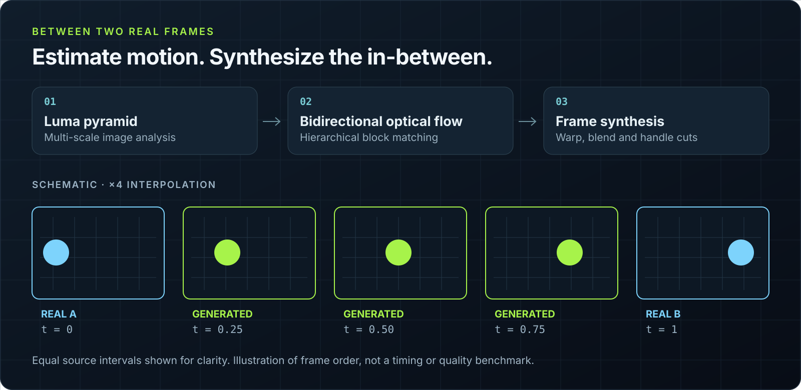
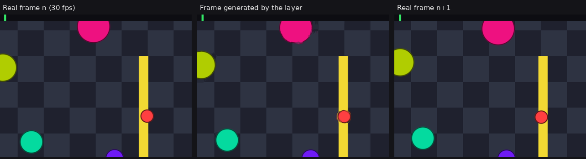
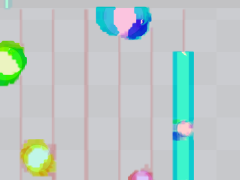

# bdex-framegen — complete technical reference

[Project overview](../README.md) · [Windows guide](../docs/windows-README.md)

## Contents

- [How it works](#how-it-works)
- [Which games](#which-games)
- [Installation](#installation)
- [Usage](#usage)
- [Configuration](#configuration)
- [Performance and quality](#performance-and-quality)
- [Limitations](#limitations)
- [Validation](#validation)
- [Development](#development)
- [Layout](#layout)
- [Contributing](#contributing)

---

## How it works

`bdex-framegen` is an **implicit Vulkan layer** (`VK_LAYER_BDEX_framegen`).
It sits between the game and the graphics driver, grabs every frame the game
presents, estimates the motion between two consecutive frames, and inserts
one or more intermediate frames before the real one.



Design notes:

| | |
|---|---|
| **Virtual swapchain** | The game renders into private images handed out by the layer. The real swapchain belongs to the layer, which decides what to present and when. |
| **Dedicated thread** | The game is never blocked by the presentation of generated frames: `vkQueuePresentKHR` costs it ≈ 0.1 ms. |
| **Separate queue** | The layer's work runs on a compute queue distinct from the game's whenever the GPU has one. |
| **No frame copies** | The images the game renders into double as the frame history: nothing is copied before the analysis. |
| **Latency first** | FIFO is replaced by mailbox + pacing from the GPU's completion (queued frames are pure display latency); the game's present returns just in time for its next frame to reach the GPU (a Reflex-like limiter); an extrapolation mode predicts the next frame instead of holding the real one back, and a hybrid mode (x3/x4) holds it only 1/m of a frame. |
| **All on the GPU** | Compute shaders handle the luma pyramid, flow, synthesis, upscaling and sharpening without a CPU round trip. |
| **Scene cuts** | When the motion cannot be explained and the brightness distribution moved too (a real cut, not grain or fast motion), the layer shows the real frame rather than a blend — per region, so a menu opening over part of the screen is not warped. |



*The middle frame was never rendered by the game: it is synthesised from the two neighbouring frames.*

<details>
<summary>See the estimated optical flow (<code>BDEX_FG_DEBUG=flow</code>)</summary>
<br>


*Hue = motion direction, saturation = magnitude. The static HUD stays grey.*
</details>

---

## Which games

The layer works on anything that presents through a Vulkan swapchain. That
covers more than native Vulkan games:

| Game | How | Status |
|---|---|---|
| Native Linux Vulkan | `BDEX_FG=1 game` | Works (demo, `vkcube`, `vkgears`) |
| Windows Direct3D 8–12 through Steam Play / Proton | `BDEX_FG=1 %command%` — DXVK and VKD3D-Proton translate to Vulkan | **Works** — verified on DXVK (Direct3D 11) and VKD3D-Proton (Direct3D 12) titles |
| Windows games outside Steam (Wine, Lutris, Heroic, Bottles) | Enable DXVK in the runner and set `BDEX_FG=1` in the environment | Same as above |
| Native Linux **OpenGL** | `bdex-framegen --gl -- game`: Mesa's Zink runs OpenGL on Vulkan (`MESA_LOADER_DRIVER_OVERRIDE=zink`, plus `__GLX_VENDOR_LIBRARY_NAME=mesa` and the Mesa EGL vendor — without them the NVIDIA driver keeps the game on its own GL, silently out of reach) | Works (`glxgears` 900 → 1800 fps on NVIDIA, an SDL3 game); Zink itself can be slower than the native GL driver on some games and iGPUs |
| Emulators, 2D engines, anything else | Run it inside [gamescope](https://github.com/ValveSoftware/gamescope) with its SDL backend: `BDEX_FG=1 gamescope --backend sdl -- game` — the compositor presents the whole game through its own Vulkan swapchain. The shipped `[gamescope]` profile exposes `VK_KHR_present_id`/`present_wait`, which gamescope requires. Put `enabled = 1` in a `[gamescope]` section (rather than `BDEX_FG=1`) to avoid generating twice for a Vulkan game inside it. The default Wayland backend presents without a swapchain: no generation there | Works (`glxgears` 337 → 675 fps) |
| Games with anti-cheat (the layer stays out), non-Vulkan programs | `bdex-capture` (capture, see [Capture mode](#capture-mode-bdex-capture-anti-cheat-games-a-second-gpu)) — X11 / Xwayland windows | Works (x2 at 0.6–10 ms on a GPU, plus the X server's round trip) |
| Software rendering / no GPU presentation | — | Not possible |

The layer never sees game logic or input: it only interpolates what reaches
the display, so generation changes presentation rather than game simulation. Compatibility still depends on the title, graphics stack and anti-cheat policy.
Steam's overlay and MangoHud sit in the same layer chain and keep working.
MangoHud usually loads *above* the layer (on the game's side): it counts and
draws on the game's frames only, its text then carried into the generated
ones. `bdex-framegen --mangohud -- <game>` (or, in Steam's launch options,
`MANGOHUD=1 VK_INSTANCE_LAYERS=VK_LAYER_BDEX_framegen:VK_LAYER_MANGOHUD_overlay_x86_64:VK_LAYER_MANGOHUD_overlay_x86 %command%`)
puts it under: it shows the frame rate on screen and draws on every frame.
Launchers installed natively (Lutris, Heroic, Bottles, itch…) need nothing:
the layer loads into their games as into Steam's.

---

## Installation

### Distribution packages

Each release also ships the prebuilt layer as packages of the distribution —
installed to `/usr`, updated and removed by its package manager:

| Distribution | Package | Install |
|---|---|---|
| Debian, Ubuntu, Mint, Pop!_OS, Zorin… | `bdex-framegen_<version>_amd64.deb` (`arm64`) | `sudo apt install ./bdex-framegen_*.deb` |
| Fedora, Nobara, openSUSE, RHEL 9… | `bdex-framegen-<version>-1.x86_64.rpm` (`aarch64`) | `sudo dnf install ./bdex-framegen-*.rpm` / `sudo zypper in ./bdex-framegen-*.rpm` |
| Bazzite, Silverblue, Kinoite (immutable) | the `.rpm` | `rpm-ostree install ./bdex-framegen-*.rpm`, reboot — or the archive below, in `~/.local` |
| Arch, Manjaro, EndeavourOS, CachyOS | `packaging/arch/bdex-framegen-bin` (prebuilt) or `-git` (from source, 32-bit layer included) | `makepkg -si` in that directory |
| NixOS | the flake (`flake.nix`) | below |

The same files as the archives (64-bit layer, 32-bit one for 32-bit games,
CLI, panel), in the distribution's library directories
(`/usr/lib/x86_64-linux-gnu`, `/usr/lib64`…). Every CI run installs the
`.deb` on Ubuntu 20.04 to 24.04 and Debian 12, the `.rpm` on Fedora and
openSUSE Tumbleweed, and generates x2 there (`tools/ci/archive-check.sh`);
`tools/package-native.sh <archive>` builds them. A package cannot write into
your home: for **Steam, Heroic, Lutris or Bottles installed as a Flatpak**
(or Steam as a Snap), run `bdex-framegen --sandboxes` once, as your user.

**Flatpak launchers** (Steam, Heroic, Lutris from Flathub): the layer also
exists as a Flatpak Vulkan layer extension, like MangoHud and vkBasalt —
`packaging/flatpak/org.freedesktop.Platform.VulkanLayer.BdexFramegen.yml`
(Freedesktop runtime 25.08, 64 and 32-bit). Once installed (`flatpak-builder
--user --install build-dir <that file>`, or from Flathub when it is
published there), every app on that runtime loads it and `flatpak update`
keeps it current; `bdex-framegen --sandboxes` then copies only the settings
into those apps. Built and loaded by the runtime's loader in CI
(`tools/ci/flatpak-check.sh`).

**Source packages for the distributions' build services** — rebuilt by the
distribution, updated with the system:

| | Recipe | Checked by |
|---|---|---|
| Fedora COPR, openSUSE Build Service | `packaging/rpm/bdex-framegen.spec` (32-bit layer on x86_64: enable multilib in COPR) | `tools/ci/srpm-check.sh` (Fedora, Tumbleweed) |
| Launchpad PPA, OBS for Debian/Ubuntu | `packaging/debian/` (copy to `debian/`) | `tools/ci/debsrc-check.sh` (Ubuntu 24.04, 22.04, Debian 12) |
| Gentoo | overlay `packaging/gentoo` (`games-util/bdex-framegen`, `ABI_X86="64 32"`, `USE=gui`) | `tools/ci/gentoo-check.sh` |
| Void Linux (glibc, musl) | `packaging/void/bdex-framegen/template` (void-packages) | `tools/ci/void-check.sh` |

Each check builds the recipe from the checkout in the distribution's
container, installs the result and checks the libraries and manifests (CI
job `source-packages`). Publishing them needs the repository to be public.

**Laptops with two GPUs**: the game should run on the GPU the screen is
plugged into, or every frame — generated ones included — is copied from one
GPU to the other (`bdex-framegen --report` says so). `bdex-framegen --gpu
screen -- <game>` (or `discrete`, `integrated`, `nvidia`, `amd`, `intel`;
`--gpu list`) sets Mesa's device selection, NVIDIA's PRIME offload and
DXVK / VKD3D-Proton's device filter.

**NixOS** — in the system's flake:

```nix
inputs.bdex-framegen.url = "github:Bdexez/bdex_frame_gen";
# ...
modules = [ bdex-framegen.nixosModules.default { programs.bdex-framegen.enable = true; } ];
```

The module installs the layer and the 32-bit one (`enable32Bit`, on by
default on x86_64) with `share/vulkan` linked into the system profile, where
the Vulkan loader finds implicit layers. (Nix on another distribution: use
that distribution's package or the archive instead — a layer linked against
the store's glibc loads into the host's games, whose glibc may be older.)
Built, and loaded by the store's Vulkan loader, in CI (job `nix`).

### Prebuilt (nothing to compile)

Download from the [GitHub releases](https://github.com/Bdexez/bdex_frame_gen/releases)
(or the `bdex-framegen-linux` artifact of any `linux` CI run):

- `bdex-framegen-linux-x86_64-<version>.tar.gz` — Intel / AMD PCs, Steam Deck
  (64-bit layer, and the 32-bit one for 32-bit games);
- `bdex-framegen-linux-aarch64-<version>.tar.gz` — ARM64: Asahi Linux (Apple
  Silicon), Snapdragon laptops, Raspberry Pi 5…
  (native ARM64 Vulkan programs; on Asahi, Steam's x86 games run in a
  muvm + FEX virtual machine whose x86_64 Vulkan loader cannot load an ARM64
  layer — not covered yet)

```sh
tar xzf bdex-framegen-linux-*.tar.gz
cd bdex-framegen-linux-*/
./install.sh          # into ~/.local: no root, also on immutable systems (SteamOS, Bazzite, Silverblue…)
```

The layers are built on Ubuntu 20.04 and carry their own C++ runtime: they
only need glibc 2.29 (x86_64) or 2.30 (arm64) — Ubuntu 20.04 and later,
Debian 11+, Linux Mint 20+, Pop!_OS, Zorin, Fedora, Arch, Manjaro,
EndeavourOS, SteamOS, Bazzite, openSUSE Leap 15.3+ and Tumbleweed, RHEL 9
and its clones — and work inside Steam's runtime (Proton games). Musl
distributions (Alpine, Void musl) build from source (below). Every CI run
installs each archive as above in other distributions' containers and runs
it on Mesa's software Vulkan with their own loader (1.2.131 to 1.4): it loads
on Ubuntu 20.04 to 24.04, Debian 11 and 12, Fedora, and generates x2 (vkcube)
everywhere Mesa can present to a virtual display — arm64 on Debian arm64
under emulation (`tools/ci/archive-check.sh`).

**Steam, Heroic, Lutris or Bottles installed as a Flatpak**: their sandbox
sees neither `~/.local` nor `~/.config`. `install.sh` also installs the layer
inside each one found (`~/.var/app/<app>/data`, where its Vulkan loader
looks), and the control panel keeps their copy of the settings up to date and
finds their games (each sandbox has its own process numbers). Install the
Flatpak launcher first (and run it once), or run `install.sh` again after
(or `bdex-framegen --sandboxes`). **Steam as a Snap** (Ubuntu's Software
centre) likewise: the layer goes into `~/snap/steam` (`common` for the
library, the manifest and settings in the snap's own home) — written from the
snap's documented layout, not yet tried on a real snap.

The control panel needs `python3-gobject` and GTK 4 (libadwaita is used when
present). Without GTK 4 (Ubuntu 20.04, Debian 11) it runs in text mode, in a
terminal — the same session, options and Steam string (`bdex-framegen-gui
--text` forces it). `./uninstall.sh` removes everything, Flatpak copies
included.
`tools/ci/package-release.sh` builds the same archives (Docker).

### Requirements (building from source)

- Linux with a Vulkan driver whose GPU does compute (Mesa RADV / ANV / NVK /
  Turnip / Honeykrisp / V3DV / lavapipe, NVIDIA…). The engine fits in the
  limits every Vulkan GPU guarantees (4 storage images per shader, 16 KB of
  shared memory — checked by the `min_limits` test); where a GPU allows less
  than 32 KB of shared memory the block matcher's optional terms stay off, and
  a GPU below the guarantees gets its frames passed through, the reason in
  `bdex-framegen --report`.
- To build: CMake ≥ 3.20, GCC ≥ 10 or Clang, the Vulkan headers ≥ 1.3.204,
  `glslc` (shaderc) or `glslangValidator` (glslang); GLFW (optional) for the
  demo. Checked in CI by building in each distribution's container, then
  running the demo through the layer there (`tools/ci/distro-check.sh`:
  Ubuntu 22.04, Debian 12, Fedora, Arch, openSUSE Tumbleweed, Alpine):

```sh
sudo apt install cmake g++ libvulkan-dev glslang-tools libglfw3-dev             # Ubuntu 22.04+, Debian 12+, Mint, Pop!_OS
sudo dnf install cmake gcc-c++ vulkan-headers vulkan-loader-devel glslang glfw-devel  # Fedora
sudo pacman -S cmake gcc vulkan-headers shaderc glfw vulkan-tools                # Arch, Manjaro, SteamOS
sudo zypper in cmake gcc-c++ vulkan-devel shaderc libglfw-devel                  # openSUSE
sudo apk add cmake g++ vulkan-headers vulkan-loader-dev glslang glfw-dev         # Alpine (musl)
```

Older Vulkan headers (Debian 11, Ubuntu 20.04): pass newer ones with
`-DBDEX_VULKAN_INCLUDE_DIR=` (CMake says how). Without a GLSL compiler,
`-DBDEX_SPIRV_DIR=<a build's layer/spv>` uses SPIR-V compiled elsewhere.

### One command

```sh
tools/install.sh      # builds and installs into ~/.local (64-bit, plus 32-bit with multilib)
```

The installation drops:

```
~/.local/lib/libVkLayer_bdex_framegen.so
~/.local/lib32/libVkLayer_bdex_framegen.so                      (32-bit games)
~/.local/share/vulkan/implicit_layer.d/VK_LAYER_BDEX_framegen.json
~/.local/share/vulkan/implicit_layer.d/VK_LAYER_BDEX_framegen_32.json
~/.local/bin/bdex-framegen                                      (launcher)
```

Uninstall: `tools/uninstall.sh`.

The 32-bit layer is built when a 32-bit C++ toolchain is installed:
`gcc-multilib g++-multilib` (Debian, Ubuntu), `glibc-devel.i686
libstdc++-devel.i686 libatomic.i686` (Fedora), `lib32-gcc-libs` (Arch).
The 32-bit Vulkan loader is not needed to build it. `BDEX_NO_32BIT=1`
skips it.

> **Arch Linux**: `packaging/arch/bdex-framegen-git/PKGBUILD` builds a
> `bdex-framegen-git` package (`makepkg -si` in that directory) installing to
> `/usr`, the 32-bit layer included (multilib); `bdex-framegen-bin` packages
> the release archive.

### Windows

Two products, built by the Windows CI (download the `bdex-framegen-windows-x64`
artifact or a release zip) — see [`docs/windows-README.md`](../docs/windows-README.md):

- **`bdex_capture.exe` — recommended.** Captures a game's window
  (Windows.Graphics.Capture), generates frames with the same engine and shows
  them in an overlay on top of the game. Works with every API (Direct3D 9–12,
  OpenGL, Vulkan) and can use capture without injecting the Vulkan layer, at the
  cost of about one frame of latency. Run it without arguments for the
  launcher (window picker, options, per-game profiles, global on/off hotkey).
  Validated on hardware on D3D9/11/12 titles (Intel iGPU + RTX 3050).
- **The Vulkan layer DLL** (native-Vulkan games and emulators): register it
  with `tools\register-layer.ps1`, then enable it per game from Steam's
  launch options (`cmd /c "set BDEX_FG=1 && %command%"`). Built and
  unit-tested by the CI but **not yet validated on Windows hardware**.

<details>
<summary>Manual build</summary>

```sh
cmake -S . -B build -DCMAKE_BUILD_TYPE=Release
cmake --build build -j
cmake --install build --prefix ~/.local

# 32-bit variant (multilib required)
cmake -S . -B build32 -DCMAKE_BUILD_TYPE=Release -DBDEX_32BIT=ON
cmake --build build32 -j && cmake --install build32 --prefix ~/.local
```
</details>

---

