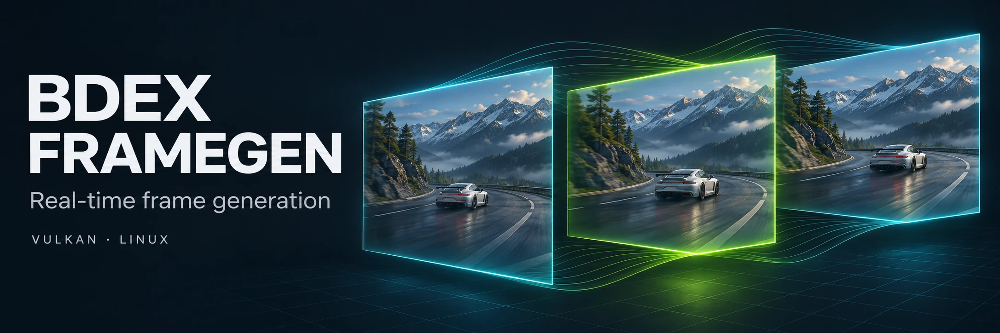

<p align="center">
  
</p>

# bdex-framegen · Windows

**The same Vulkan generation engine, with a Windows launcher and two integration paths.**

The x64 package includes `bdex_capture.exe`, the Vulkan layer DLL and supporting tools. Despite its name, `bdex_capture.exe` is also the launcher for automatic layer injection; choose the method that suits the game.

[Main project](../README.md) · [Detailed Windows guide](windows-reference.md) · [Hardware validation notes](windows-capture.md)

## Choose an integration path

| Method | How it works | Current status |
| :--- | :--- | :--- |
| **Capture** | Windows.Graphics.Capture supplies images to the shared Vulkan engine, which presents them in an overlay. | Hardware validation is recorded for D3D9/11/12 titles; requires windowed or borderless presentation. |
| **Layer injection** | The layer virtualizes the game's Vulkan swapchain. The launcher can also prepare DXVK / VKD3D-Proton for Direct3D titles. | Built in CI and exercised under Wine; native Windows hardware validation remains open. |
| **Auto** | The launcher selects injection where the setup allows it and falls back to capture. | Default launcher behavior; may prepare translation-layer files for the next game start. |

Capture avoids loading the Vulkan layer into the target process. Compatibility with a game's anti-cheat policy is still title-specific; the launcher explains its method selection and related warnings.

## Start a session

1. Obtain the `bdex-framegen-windows-x64` package from the repository's [Actions artifacts](https://github.com/Bdexez/bdex_frame_gen/actions/workflows/windows.yml) or [release assets](https://github.com/Bdexez/bdex_frame_gen/releases).
2. Start the game in windowed or borderless mode if using capture.
3. Run `bdex_capture.exe`, select the game window, choose **Auto**, **Injection** or **Capture**, and start with ×2 interpolation.
4. Compare generation on/off, then adjust the preset, multiplier and optional GPU calibration result.

The launcher supports per-game profiles, advanced engine settings, GPU selection and a diagnostic report. A different generation GPU uses the capture path.

| Shortcut | Action |
| :--- | :--- |
| **Ctrl+Alt+G** | Toggle generation during a session |
| **Ctrl+Alt+Q** | Stop the capture session |

Shortcuts can be changed in the configuration. Capture adds its own acquisition and presentation costs; interpolation also needs both source frames before synthesizing the images between them.

## Command-line capture

Providing capture arguments selects the command-line capture path:

```powershell
.dex_capture.exe --list
.dex_capture.exe --pid 1234 --multiplier 2
.dex_capture.exe --title "Kenshi" --mode interpolate --fit
```

Replace `1234` with the game's process ID or use the exact window title. The [complete guide](windows-reference.md) covers HDR, profiles, injection removal and the full CLI.

## Configuration and diagnostics

| Item | Location or action |
| :--- | :--- |
| Shared settings | `%APPDATA%\bdex-framegen\bdex-framegen.conf` |
| Per-game settings | A section named after the game's executable |
| Runtime status | `%TEMP%\bdex-framegen\<pid>.status` |
| Problem report | Use the launcher's diagnostic-report action |

[Windows layer setup](windows-port.md) · [Capture architecture and validation](windows-capture.md) · [Roadmap](../ROADMAP.md)
